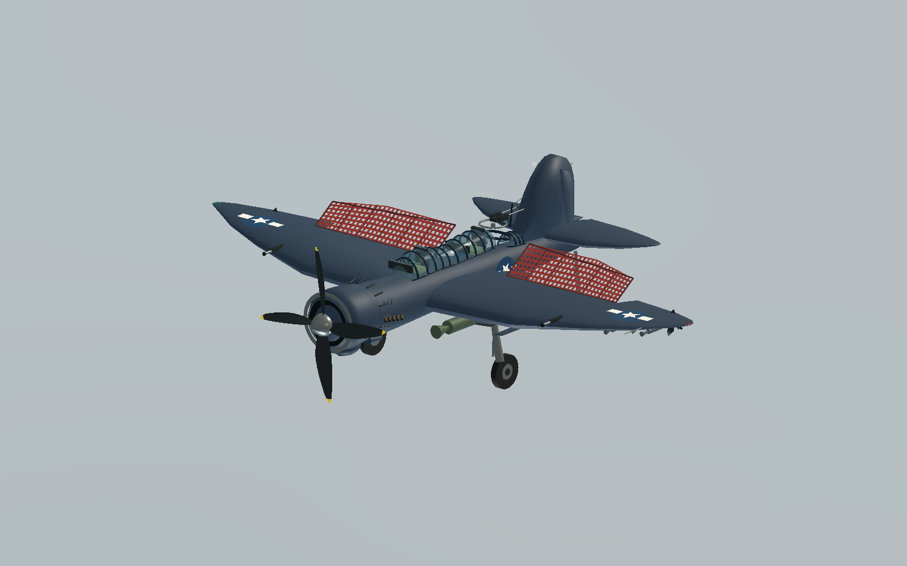

# SB2C-4 第 2 轮形体复核

状态：上一轮造型验收未通过；本轮按反馈修改，等待复核。浏览器实测仍暂缓。

## 参考与当前模型：前侧三分之四

参考图 extra_09 与当前模型都以机头在左、从前侧上方观察，便于比较座舱、翼面、垂尾和尾段。

| 参考照片 | 当前模型（减速板展开、挂载细节） |
| --- | --- |
|  |  |

另一张高位后侧参考图：[extra_10.jpg](../references/bombers/sb2c/extra_10.jpg)。

## 修改前后

| 视角 | 上轮退回图 | 本轮修订图 |
| --- | --- | --- |
| 侧视 | [第 1 轮](../../aircraft/sb2c4/screenshots/round1-before-supervisor-review/sb2c4-side.png) | [第 2 轮，干净构型](../../aircraft/sb2c4/screenshots/round2/sb2c4-round2-clean-side.png) · [展开细节](../../aircraft/sb2c4/screenshots/round2/sb2c4-round2-detail-side.png) |
| 俯视 | [第 1 轮](../../aircraft/sb2c4/screenshots/round1-before-supervisor-review/sb2c4-top.png) | [第 2 轮，干净构型](../../aircraft/sb2c4/screenshots/round2/sb2c4-round2-clean-top.png) · [展开细节](../../aircraft/sb2c4/screenshots/round2/sb2c4-round2-detail-top.png) |

## 复核要点

- 垂尾边界闭合且圆顶，方向舵贴合垂尾；后机身上部延伸到平尾根部，尾轮安装点进入机身轮廓。
- 飞行员与观察员玻璃罩连续，框架沿罩体弧面；后座炮手位置为明确的开放状态，后面接玻璃整流罩。
- 主翼有清楚的根翼/外翼折线与收尖圆钝翼尖；尾翼采用分段平面形。
- 炸弹位于有舱口边缘和内衬的机腹炸弹舱内，舱门与弹架可见；干净构型关闭舱门并折叠减速板、隐藏挂载。
- 新截图使用明亮中性背景和补光；腹视与腹部斜视便于观察机腹和炸弹舱。

## 截图索引

- [干净前侧三分之四](../../aircraft/sb2c4/screenshots/round2/sb2c4-round2-clean-front-port.png)
- [干净侧视](../../aircraft/sb2c4/screenshots/round2/sb2c4-round2-clean-side.png)
- [干净俯视](../../aircraft/sb2c4/screenshots/round2/sb2c4-round2-clean-top.png)
- [干净腹视](../../aircraft/sb2c4/screenshots/round2/sb2c4-round2-clean-underside.png)
- [展开细节后侧三分之四](../../aircraft/sb2c4/screenshots/round2/sb2c4-round2-detail-rear-quarter.png)
- [展开细节机腹斜视](../../aircraft/sb2c4/screenshots/round2/sb2c4-round2-detail-underside-quarter.png)
