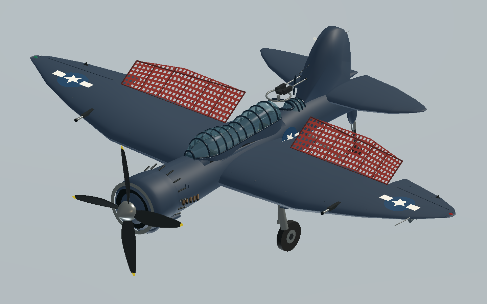

# SB2C-4 第 3 轮形体复核

**状态：监督复核未通过，作为历史记录归档。** 本文件里的截图与说明只对应第 3 轮旧模型，不代表后续源码。监督反馈见[复核意见](sb2c4-review-round3-supervisor.md)；第 4 轮尚未生成截图。浏览器实测仍暂缓。

## 参考与本轮视图

对照监督指定的 extra_09，调整前侧三分之四取景，使机头朝左、座舱和翼面清楚可见，并让主体约占画面 80%。

| 参考图 extra_09 | SB2C-4 本轮前侧三分之四 |
| --- | --- |
|  |  |

## 本轮针对复核意见的修改

- **座舱根部：** 增加与机身连续的座舱边沿和窗框支柱，封闭挡风玻璃；调整内部侧壁、地板和双座位置，使座椅落在罩体和机身开口之内。俯视近景可检查玻璃温室、边框和座椅。
- **尾轮安装：** 把尾轮支柱上端接到机腹整流罩，缩小整流罩并重排上支柱、活塞、叉架和轮胎，避免顶部断开或变成单独长杆。
- **后机身：** 加宽并加高炮手舱后方到平尾根部的截面，让尾段从座舱后方向尾轮位置连续收束。
- **翼面与操纵面：** 主翼网格在副翼边界插入精确站位，并从上下翼面切出副翼开口；独立副翼面片沿真实翼型坐标落在铰链边，减少重叠造成的浮条或闪烁。翼根分裂减速板保留独立上下襟板和开槽翼面。
- **炸弹舱：** 开闭两种状态共用同一对弧形门网格；打开状态绕侧边铰链下翻并显示支撑杆，炸弹弹架通过挂耳支撑炸弹。闭合状态使用机身涂色，贴合机腹。
- **画面：** 前侧三分之四视图按 extra_09 调整构图；补充座舱、尾轮、副翼、翼根减速板和炸弹舱近景。

## 截图索引

- [前侧三分之四（展开细节）](../../aircraft/sb2c4/screenshots/round3/sb2c4-round3-detail-front-port.png)
- [干净侧视](../../aircraft/sb2c4/screenshots/round3/sb2c4-round3-clean-side.png)
- [干净俯视](../../aircraft/sb2c4/screenshots/round3/sb2c4-round3-clean-top.png)
- [干净腹视（闭合舱门）](../../aircraft/sb2c4/screenshots/round3/sb2c4-round3-clean-underside.png)
- [后侧三分之四（展开细节）](../../aircraft/sb2c4/screenshots/round3/sb2c4-round3-detail-rear-quarter.png)
- [机腹斜视](../../aircraft/sb2c4/screenshots/round3/sb2c4-round3-detail-underside-quarter.png)
- [炸弹舱、挂架与开门](../../aircraft/sb2c4/screenshots/round3/sb2c4-round3-detail-bomb-bay.png)
- [副翼与铰链贴合](../../aircraft/sb2c4/screenshots/round3/sb2c4-round3-detail-aileron-fit.png)
- [翼根上下减速板贴合](../../aircraft/sb2c4/screenshots/round3/sb2c4-round3-detail-wing-root-fit.png)
- [座舱根部与内部](../../aircraft/sb2c4/screenshots/round3/sb2c4-round3-detail-cockpit-root.png)
- [尾轮上端与机腹连接](../../aircraft/sb2c4/screenshots/round3/sb2c4-round3-detail-tailwheel-root.png)

## 验证与限制

- 使用 Godot `4.7.2.stable.official.ed1daf0bf` 和 Compatibility 渲染器运行独立检视场景；本轮 11 张 PNG 均由本机 Godot 视口捕获，单次进程保存后自动退出。
- 仅完成模型视图检查；未进行 Safari、Chrome、浏览器导出或性能实测。
- 4.496 m 机高仍参考同系列 SB2C-5 资料作估值；8 枚 HVAR 与一枚 500 lb 炸弹是结构展示，不代表标准出击挂载。来源和限制见[参考记录](../references/bombers/sb2c/README.md)。
- 目前所有挂载和控制面是静态展示，尚未连接模拟运行时动画。下一机型仍待 SB2C-4 复核通过后再开始。
