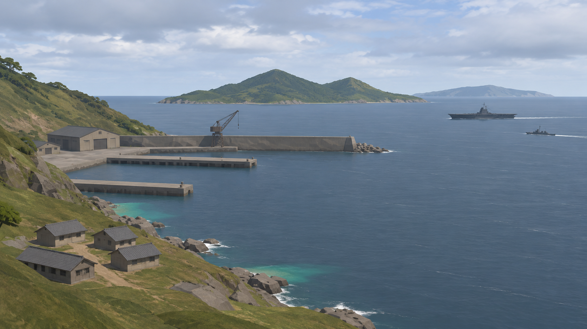

# 青岬群岛 · 从港口看见机群归航

2026-11-19 设计提案。首版做放置观战，第二版开放编队级指挥。建议先用一座港湾、一支能叫出名字的编队和一个有结局的任务，做出可以从头看到尾的一局。

## 观众为什么愿意等

我希望观众在海面上找一架飞机。几分钟前，他看着这架地狱猫翻过机腹，跟丢过它，又在指挥态势里看到它收到返航令。现在从甲板向外看，海天交界处出现一个小黑点。观众知道自己在等谁。飞机可能落舰，也可能复飞，甚至始终没有回来。每一种结果都值得看，因为观众记得它出发时的样子。

这要求三件事同时成立。观众能认出这是哪片海，能认出前后是同一支编队，最后能查到它实际去了哪里。这三件事也是下一轮挑选画面和功能的依据。

## 一片能认路的海

当前实机里，零战大坡度飞行的轮廓已经清楚，翻过来时机腹有近乎纯白的一面，翼根和机身容易连在一起。岛的浅色岸缘很连续，高空看时比港口轮廓抢眼。舰侧截图里，水面的细纹已经能交代近景，展开的双方指令和上下两排操作则同时占据了画面。现有的港湾、起重机、双峰岛和防波堤已足够支撑下一轮。 [空战实机](../../showcase/evidence/2026-11-19-aerial-motion/ego-duel.png) · [舰队实机](../../showcase/evidence/2026-11-19-command-and-smoke/live-ship.png) · [青岬地图](../../maps/island_harbor.md)

| 构图 | 我想保留的画面 | Godot 里先做的改动 |
| --- | --- | --- |
| 港口外景 | 从山坡上的屋顶望过去，防波堤截开内外海，两座远峰之间看得见舰队拖长的航迹 | 用既有几何分出小镇的低矮屋顶、军港笔直的岸壁和远山三个层次。深水用石板蓝，内湾用灰绿，只在迎浪岬角点出少量碎白。远处降低波纹对比，舰艉尾迹随实际航速渐窄 |
| 空中随队 | 飞机偏在画面一侧，机头前有余地。翻滚时地平线仍然水平，机翼下面有一截山脊或港口，让观众看出整架飞机抬高了多少 | 先调海天明暗与机腹高光，让深蓝机背仍有层次、浅色机腹看得出弧面。沿用连续跟拍，在同一次机动里给坡度建立、转弯和收平留出完整镜头。对手进入合适构图时再拉宽 |
| 飞行甲板 | 近处是暖灰甲板，舰艉之外是白色尾迹，远处只有一架归来的飞机。镜头可以安静几秒 | 用舰上固定观察点与真实进近、复飞、回收状态选镜头。压低甲板细纹，用现有本地合成的风、舰机动力和距离衰减，让飞机的接近先被听见 |

建议把港口图里的冷暖、前中远景和安静水面定为起点。近岸石块、坡上植被和甲板木纹在游戏里可以再省一级。三张草图分别构图，取用它们的光线和机位。地图、舰名日期、主副炮布置、机翼和座舱盖继续按已有资料与模型定形。 [空中随队草图](fighters.png) · [甲板归航草图](flight-deck.png) · [ImageGen 原始提示词](concepts.md)

**烟火需要让观众读出发生了什么。** 齐射近景留出炮口外的空海面，第一团烟交代发射位置，漂散的烟交代风向。海面弹着留高而短的水柱和稍久的泡沫，空爆留一团边缘参差的灰黑烟，损伤浓烟从受损单位带出。曳光短暂揭示飞行方向。所有表现消费已有发射、接触、损伤和环境状态。画面繁忙时优先削减远景重复烟层，保住近处的动作轮廓和真实命中事件。 [现有烟效与指挥验收](../../deliveries/2026-11-19-command-and-smoke.md)

## 首版观战怎么玩

| 玩家此刻想知道什么 | 观众可以做什么 | 游戏应给出的反馈 |
| --- | --- | --- |
| 这一局争什么 | 开局读一句双方任务，直接开始，也可点名关注一个编队 | 给出舰名、编队名和地图上的出发地／目的地。放下操作也能一路看到结算 |
| 刚才那队飞机呢 | 点「关注任务」。可以跟到空中、切到它的母舰，或者暂时自由观察 | 关注记录跟着任务走。镜头切走、长僚机分开或一架退出后，仍能从同一入口查到每架的最后状态 |
| 刚才我错过了什么 | 打开「态势」，查看关注对象最近三次状态变化 | 每条显示下令人、受令编队、执行状态、发生时间和已有原因。查看文字保留当前镜头，点「定位」才换机位 |
| 结果为什么是这样 | 看战报，再选同一初态换视角，或换一个种子 | 第一行回答主要任务。下面列出改变结果的几件事，再列已回收、改降、损失、舰艇失能和安全撤出。同一初态换视角可复核同一战局 |

延续已选的**外围轻 HUD**。默认上沿左右各留一条真实任务摘要，注明舰队或航空岗位、受令对象和当前状态。底沿留播放、跟拍和态势入口。展开态势可以看到双方四个岗位，菜单中的武器检视、专项训练和重开归在验证入口。纯电影、手动跟随、自由观察都保留。 [已选界面方向](../../ui/concepts/directions.md) · [指令与状态契约](../../showcase/command-and-observer-ui.md)

## 第一场值得反复看的任务

**建议样片名为《青岬归航》。** 美方的埃塞克斯要接回一个已登记的 F6F 双机波次，并驶入外海撤离区。日方在有效任务窗口内阻止对方完整撤出。先复用已经有单机／双机作业基础的埃塞克斯与 F6F。双方航空和舰队指挥官继续依各自情报、可用编队及伤情下令，轰炸、截击、舰炮和岸上单位各自执行能承担的游戏任务。陆基 B-25 和一式陆攻沿各自任务返场。 [港湾场景配置](../../../data/scenarios/s14_expansion_harbor.json) · [舰载机作业基础](../../showcase/deliveries/OPS01-model-resume.md)

**结算草案。** 简报先指明两架飞机的身份、指定母舰、撤离区和任务窗口。每架飞机须在这次出动后有指定母舰的真实回收记录，且撤出时仍在舰上，才计入随舰返回。同一架复飞数次也只计一次。在甲板上出生、只接到返航令或回收后再次出动，都按实际状态记入时间线。

| 正式场景终态 | 玩家看到的结果 |
| --- | --- |
| 母舰实际驶离，两架指定机都已回收并随舰返回 | 美方任务达成，列出两架的回收时间 |
| 母舰实际驶离，随舰返回一架或零架 | 美方完成撤出，日方阻止了整队随舰返回。分别交代其余飞机已确认的去向 |
| 母舰已沉没，或任务窗口结束时仍未抵达撤离区 | 日方达成阻止撤出的目标。已回收、改降、仍在空中和确认损失各自列出。曾回收记录只说明当时的甲板作业 |
| 观众提前结束，目标尚可继续 | 记为中断，保存当时态势。遇到原因不明的失联，战报保留「去向未明」 |

建议用 **8–12 个模拟分钟**校准这段短任务的可读性，完整首版对局沿用总体规划的 20–40 分钟目标。任务窗口是开局公开的场景条件，摄影只观察其间真实发生的事。若没有飞机抵达甲板，可以跟随另一架返场，也可以停留在受损舰旁，让战报解释结果。验证 Showcase 与正式任务共用地图和模拟，各有入口。

### 在同一张图上换一种玩法

| 任务 | 玩家在意的悬念 | 怎样结算 |
| --- | --- | --- |
| 青岬归航 | 跟出去的双机，还能不能在母舰甲板上看到两架 | 核对同一次出动、实际回收和随舰撤出的名单 |
| 双峰海峡护航 | 主舰还能走，掉队的护航舰能跟上吗 | 逐舰核对抵达终点和安全撤出的状态，同时交代掉队舰是失去动力、失能漂浮还是最终沉没。战列舰与驱逐舰各自的损伤后果在这局更容易看懂 |
| 港口值勤 | 同一座港口从轰炸机、拦截机和岸上三个位置看，发生的是同一件事吗 | 首段选择已有功能状态的港区岸防单位为对象，按任务窗口结束时是否仍可执行任务判定，另列空中编队返场与损伤。陆基编队与舰载编队回到各自能使用的基地或母舰 |

复玩的第一层是换观察对象。上局盯舰艏，这局跟同一架僚机，能看到同一个决定的另一面。第二层是换初态，关心同一任务在不同可用兵力和初始情报下会怎样收场。优先做一个轻量的本地任务日志，按场景、种子、关注编队和结果查找。战后先支持事件时间线和同种子重看，需要任意时刻跳转的录像存档留到单独评估。

## 第二版让玩家坐上一个指挥席

首个可玩指挥席建议选**单方航空指挥官**。玩家已经在观战时读懂过这些命令，可以从一个清楚的取舍开始。让值勤双机继续在空中，舰队暂时多一组可用飞机，但它们的余油在下降。现在让它们返航，就得看到空中值勤缺口和甲板排队的后果。接令、排队、复飞、改降或中止均由原有系统回报。界面只展示当时已有的信息，战后再开放双方视角对照。

玩家可以维持进攻、平衡或保守的编队意图，也可直接给选定编队派一项任务。姿态改变任务分配和预备队取舍，装备仍按各自参数运作。接手期间，这个岗位的同一编队有一个发令来源。另一岗位继续由 AI 运作。玩家和 AI 共用命令校验、拒绝原因、分发和回报。确认航空席有选择、有代价、能解释后果，再把同一交互扩展到舰队席。 [当前两个岗位的行为](../../deliveries/CMD02.md)

舰队席可以先只做一个有分量的选择。护航舰动力受损后，玩家让主队等待重组，代价是撤离窗口缩短。也可以让主队继续原任务，同时为掉队舰保留一项独立返航任务。战报把主队是否准时、掉队舰的最后状态放在一起，玩家能判断自己愿意承担哪种结果。

## Codex 与 Godot 的下一轮顺序

| 批次 | 执行分工 | 统筹验收 |
| --- | --- | --- |
| 第一批 | 两个执行聊天可并行。一边定位正式港湾的模拟、渲染与 HUD 各自耗时。另一边在独立场景定义《青岬归航》的出动名册、任务条件和战报数据 | 同一初态、同一机位、1 倍速比较原生和 Ego Lite。用完成、部分达成、未达成、手动中断的可控输入逐项核账，另留自然运行记录 |
| 第二批 | 复用已量出的开销。一边改海岸、远山、海天明暗和单位受光。另一边用已确定的任务数据接观战 HUD、任务关注和三个真实机位 | 同一机位改前改后各留一张图和一段运动画面。正常视距能分辨航道或港口，能看完一次机动。收起 HUD、锁定镜头和换视角，战局结果应一致 |
| 第三批 | 统筹串行验收完整短局。通过后再安排第二版的航空指挥席原型 | 一个第一次看的观众能从开局说出目标，离开片刻能找回关注编队，结算时能解释一条指令为何完成或失败 |

普通港湾目前有 27 个单位。上一轮 M5／16 GB 原生跟拍采样 P95 为 42.0 毫秒。Ego Lite 自动化窗口里，720p 普通页的实际画面帧间隔 P95 约 1.05 秒。两种测法分别记录。浏览器优先的项目目标仍为 1440 × 900、1 倍速、P95 不高于 33.3 毫秒。优先保证现有单位运动、烟和任务可读，再扩大同时出现的单位数。每批最多两个 GPT-6.2 Sol High 执行聊天，Godot 和浏览器验证串行，统筹保留最终验收。以上为本轮设计建议。 [性能实测](../../deliveries/2026-11-19-aerial-motion.md) · [项目规模与性能目标](../../project-plan.md)
