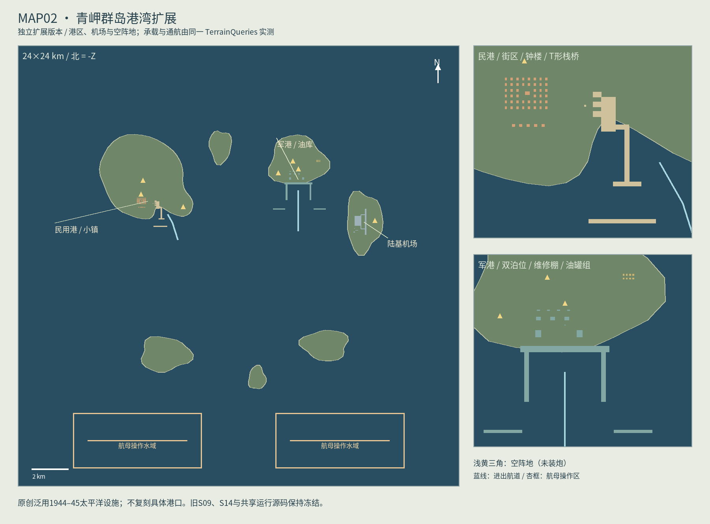

# MAP02 区域与布局（2026-11-11）

本图按独立 `data/maps/island_harbor_expanded.json` 和 `data/map02/regions.json` 生成。属于原创架空港湾，设施参考1944–45太平洋港口的功能组合，不宣称复原关岛或某处日军基地。布局先行后已用未改动的TerrainQueries/TerrainNavigation验证承载、首次接触及通航；当前独立版交付见[MAP02记录](../../showcase/deliveries/MAP02.md)。

| 区域 | 约中心[x,z] m | 空中识别与用途 |
| --- | --- | --- |
| 民用港口 / 小镇 | [-4900,-3400] | 低层屋顶街区、公共会馆钟楼、商铺、货仓、T形码头和单座吊机 |
| 军港 | [3250,-4500] | 两条900m泊位、横向岸壁、大型维修棚/军需仓/营房/控制塔 |
| 油库 | [4350,-5700] | 独立8座圆筒罐，与维修区分开；场景尺寸为近似 |
| 防波堤 / 入口 | 民港[-4250,-2160]；军港[3300,-3100] | 低矮实体防波堤、明确进出航道和预留回转水面 |
| 陆基机场预留 | [6800,-2400] | 1400×58m跑道、16m滑行道、8个停机位、机库、场站塔与净空走廊 |
| 岸防与高地防空 | 主岛/军港两侧 | 共7个具名空阵地，高低分散；不放装饰炮，不注册战斗单位 |
| 航母外海操作 | x=-9000～-2000及2000～9000，z=8000～11000 | 每方7×3km水域、5400m航行/迎风直线与进近参考线；仅几何净空 |

独立入口为 `scenes/map02/expanded_map.tscn`，不替换S14、共享Session或旧地图。区域坐标、航道、服务挂点、机场和航母空间字段集中在regions.json；设施模块与实例分别在facility_modules.json和facility_instances.json，生成工具为tools/map02/build_map.py。共12类模块、99处设施实例、432条组件/硬地记录，模块检视入口为 `scenes/map02/facilities.tscn`。

机场对照已有Woleai原型（1003m/58m跑道表现、625m/16m滑行道、3.5m岛面）核对使用组织和尺度。MAP02为新的山岛机场预留，跑道延长至1400m、台面8.04m、滑行纵段760m均为明确场景近似；不把旧原型的航点演示当作OPS01起降闭环，也不保证所有双发机在此长度可起降。
