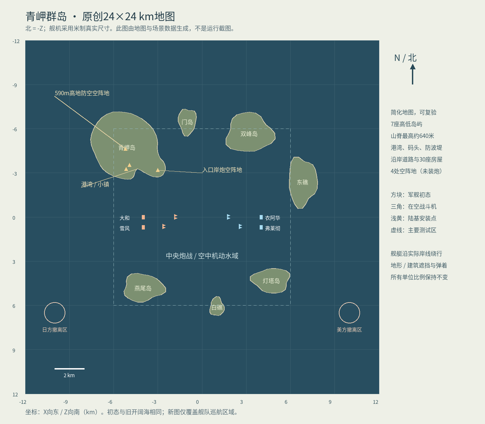

# 青岬群岛地图

S09原创白昼海空战测试图。状态：实施与自验收完成，统筹机制/原生复核通过，最终索引待核对；Chrome最终性能属于S08。根工程默认大和查看器保持不变。



## 入口与场景选择

```sh
python3 tools/verify.py --owner map-preview --timeout 1200 godot --render -- res://showcase/island_harbor.tscn
python3 tools/verify.py --owner sea-baseline --timeout 1200 godot --render -- res://showcase/open_sea.tscn
```

`showcase/first_playable.tscn`的共享实现现在默认读取 `data/scenarios/island_harbor.json`，因此S08重建后的Showcase采用新图。`showcase/open_sea.tscn`显式读取未改动的 `data/scenarios/first_playable.json`。两者复用同一个游戏/session/命令/火控/航空实现；没有第二份战斗逻辑。现有 `tools/run_first_playable.py native` 也采用新图；旧 `build/first-playable` 是冻结历史诊断包，不能作新地图验收，S08必须重新 `--build`。

坐标米、+Y上、-Z北；场景24×24km范围为x/z各±12000，主要测试区约12×12km，中央约8×4.4km连续水面支持8km初距炮战。不是将装备缩小以容纳岛屿。活动边界用于海图定位和场景组织，尚未添加强制边界墙或自动越界判负。

| 区域 | 参考中心[x,z] m | 实际内容 |
| --- | --- | --- |
| 青岬主岛 | [-5100,-4750] | 最高约640m山脊、东南港湾、低岸小镇与高低阵地 |
| 双峰岛 | [3200,-5700] | 东北高岛/水道遮挡 |
| 门岛 | [-1000,-6500] | 中北狭水道，实际舰艇绕岛见证使用此岛 |
| 东礁 | [6800,-2400] | 狭长东侧岛岸 |
| 灯塔岛 | [4700,4300] | 东南低岛 |
| 燕尾岛 | [-4000,4800] | 西南不规则轮廓 |
| 白礁 | [1000,6100] | 南侧小岩岛 |
| 港湾内水面 | [-3950,-2600] | 从中央海域实际可达；190m舰体安全膨胀图仍有通路 |
| 日/美撤离区 | [-10000,6500] / [10000,6500] | 舰艇半径700m；飞机使用同一xz和1500m高度、半径600m |

四舰出生点为x±4000、z0/700、y0；八机保留旧场景的x±1800/±2600、高度900–1045m初态与余油。新图仅覆盖指挥官巡航区：日方中心[-3700,0,-900]半径900m，美方[3500,0,-900]半径1400m，避免原北向巡航区延伸至岛岸。撤离区、型号、服役年代、历史尺寸、武器/血量/射速/库存均保持。

## 一份地形来源

`data/maps/island_harbor.json`保存岸线、中心、山峰、台地、房屋/码头、道路、安装点和观战位置。安装时编译为9444个三角形及320m分区索引；模型顶点、碰撞面和高度插值完全相同。径向分环是小场景的低成本选择：岛岸须为相对于指定中心的星形多边形，安装时检查每条边，禁止径向重叠。不能任意导入带洞或多重折返的多边形；那类地形需改为约束三角剖分。

建筑采用有屋顶高度的保守AABB，30幢房屋、3幢仓库、4段码头/防波堤、1座港灯共38个实物代理；2架细杆起重机为装饰，不设隐藏大盒。建筑基础根据最终三角面四角高差生成，墙体与基础均从同一编译数据得到，墙根不悬空；道路每20m分段贴地。岛岸与建筑不会被炮弹/坠机穿过。海面仍是y=0的真实接触面，视觉波纹不改变碰撞。

`TerrainQueries`只读API见[契约](../terrain-contracts.md)。CombatContacts调用线段查询遮挡探测；CombatWeapons检查炮口近前400m，后续弹道由CombatProjectiles逐段实际扫掠，不用直线视线封死越山曲射；CombatDamage的坠落和空爆遮挡也复用它。S04直接消费地形高度/线段，不在本板块新增航空逻辑。

航行从同一岸线生成11个受控多边形，按0.55×舰长＋45m膨胀；规划另加1/4回转半径并缓存可视图，不为每个三角面生成导航节点。不可达目标停止并向真实任务回报`blocked/coast_unreachable`；路线和船体运动连续，不改坐标绕过障碍。不能处理潮汐/吃水、拥挤港口调度或完整海底。

相机用同源高度和视线抬升避让；近裁面随观察距离在0.8–80m调整，防止22km全景的深度精度造成海陆闪烁。地图与单位态势同源；地点定位在720p底部控制栏，保持双方四张任务卡可见。定位只操作相机。

## 给S10的承载点

安装位置是承载地面，不是炮口。`clearance_m=0`；具体兵器自行提供真实安装基准和炮口。下表均为空阵地，`ground_deployments=[]`，没有参战单位、伤害或假火力。

| 稳定id | [x,y,z] m | 半径 | 朝向/射界（相对朝向） | 角色 / 建议阵营 |
| --- | --- | ---: | --- | --- |
| harbor_coast_01 | [-3010,32,-3200] | 32m | yaw=-2.35rad；水平±70°、俯仰-5～45° | coastal_gun / jp |
| harbor_aa_01 | [-4930,18,-3540] | 24m | yaw=0；水平±180°、俯仰-5～85° | light_aa / heavy_aa / jp |
| ridge_aa_01 | [-5200,590,-4630] | 26m | yaw=0；水平±180°、俯仰-5～85° | light_aa / heavy_aa / jp |
| harbor_aa_02 | [-5150,18,-3250] | 22m | yaw=0；水平±180°、俯仰-5～85° | light_aa / jp |

每点实测24向完整半径足印均为陆地，平整高差<0.1m，声明高度与真实三角面吻合。炮口代理高4m、前方120m检查存在有效方向；实际兵器仍需按目标高度和自身几何检查，表中推荐射界不是无条件穿山许可。高地最初390m台地会深切山坡，最终修正到接近自然地表的590m，避免把防空炮放在深坑中。

S10可由场景的`ground_deployments`按site_id/definition_id/faction_id选择部署，不需改地图生成代码。本板块只提供数据与真实承载，尚未实现该数组的武器实例化。

## 外观与预算

海面使用非同周期且经噪声扰相的统一风向波纹；所有频率按屏幕导数过滤，模拟时间控制暂停/重开。岸线只用薄浅水/泡沫带，没有流体、海底、潮汐和复杂反射。地表/建筑顶点色显式转线性，保持Compatibility下颜色稳定；公里级地形不投射舰艇近距离级联阴影，小物件和舰艇保留基础阴影。小镇不做室内或逐栋复杂破坏，植物只用稀疏简化锥形组团。

地图静态5节点、4个MeshInstance、3种材质；最终实际数量与开关地图的同镜头绘制对照见S09的native_capture.json。隐藏地图仍保留其资源，所以该对照只隔离绘制成本，不宣称测得释放地图后的内存差。浏览器720p帧时间、音频和长期内存仍须S08仅在Chrome测量。
