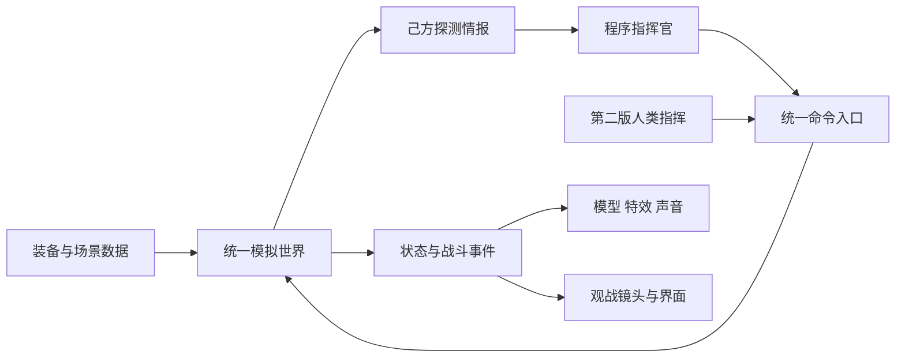

# 海空战游戏总体规划

更新：2026-11-11。按用户最新要求，第一版采用简化画面，重点完成单位行为与观战体验；开发全过程以 Codex 编写和维护项目、Godot 运行和验证为基础。执行任务见[开发任务清单](development-tasks.md)。

当前用户已授权继续实施港口/军港/小镇、防空阵地、美日航母与舰载机作业、各一款大小轰炸机及轰炸模式。按[Showcase扩展计划](showcase/expansion-plan.md)拆分聊天，由统筹验收；最多两个执行聊天、一个重型验证。先交付当前全单位Showcase的可用版本与启动方式，再分批接入扩展。下文整体首版规模仍为目标，不因局部验收而算全部完成。

2026-11-19 的[青岬观战与指挥玩法提案](design/qingjia/README.md)将港湾美术、任务观战、首场结算和第二版指挥席串成一条游玩路线，附三张美术草图与建议验收顺序。

本文替换此前偏重细节的首版方案。任务依赖、交付物与验收要详细，画面和物理实现控制在下述范围。下列具体初值与实现顺序属于规划，不代表功能已经完成。

## 1. 产品与版本

第一版是一场能够自己进行的二战海空战。用户选择场景后，可以放置观看、自动看电影镜头，也可以自由观察、跟随单位、暂停和调整播放速度。程序指挥官组织战斗，单位依照任务搜索、编队、交战、撤离和返航。

- 固定 Godot `4.7.2.stable.official.ed1daf0bf`、带类型 GDScript、Compatibility，使用匹配的导出模板。
- 浏览器优先，基准设备为 M5／16 GB。根据用户 2026-11-19 的要求，仅使用 Ego Lite 验收。
- 首场为美日架空海战，允许二战装备跨年代组合，保留型号与年代属性。
- 最终规模仍为每方 20–30 艘军舰、100 架飞机总编制；在空、停放、整备和返航数量分别统计。
- 首版覆盖炮战、防空、战斗机协同、航空攻击、航母起降；机场和大型陆基飞机按任务清单接入。
- 场次以约 20–40 分钟可持续观看为目标，不强行保证全灭或固定时刻结束。
- 尺寸和关键性能尽可能依据历史资料；缺少资料的值明确标记估算，不为双方对称而修改装备。
- 第二版加入人类舰队／航空任务指挥。高层命令替换输入来源，复用第一版单位执行逻辑。

“每方 24 艘”是推荐标准配置，100 架是总编制。此前额外增加 18 架陆基飞机的建议没有作为新基准确认；场景需明确是否计入 100 架，任何额外单位都进入性能预算。

## 2. 第一版的复杂度上限

### 画面标准

目标是清楚、协调、能看出单位和交战动作的简化三维画面。电影感主要来自运动、构图、齐射节奏、烟迹与声音。

| 内容 | 第一版做到 | 后置内容 |
| --- | --- | --- |
| 军舰 | 舰体与上层建筑外形一致；主副炮编制和位置完全符合所选配置；独立转塔与俯仰；专用防空炮数量另按游戏需求规划 | 铆钉、细孔、复杂栏杆、内舱、全套索具与管线 |
| 飞机 | 机身／机翼／尾翼／座舱盖及武器的外形与比例还原，连续机头外壳、少量罩框、螺旋桨、简化起落架与必要挂载 | 发动机内部、完整座舱、复杂液压机构、蒙皮纹理、每个控制面的精细联动 |
| 海面 | 简单颜色、波纹／法线、轻微舰体起伏、尾迹 | 流体求解、船体排水波、复杂反射、逐浪浮力 |
| 岛屿、城镇与港口 | 可辨山岛/岸线、少量街区/码头/仓库、可承载岸炮和防空炮的阵地；统一高度/遮挡/碰撞/导航 | 大量植被、可进入建筑、复杂地形破坏、港务流程 |
| 机场（后续航空作业） | 轮廓、基础地形、跑道、少量机库和防空阵地 | 精细地勤与机场内部设施 |
| 射击 | 实际炮口、短闪光、简化烟、少量可见曳光、炮管后坐 | 大量逐发显示节点、精细抛壳与供弹动画 |
| 命中 | 海面水花、地面尘土、舰体火花／烟、基础空爆 | 逐片破片、精细碎裂、复杂粒子碰撞 |
| 损伤 | 减速、失火、武器失效；飞机发动机失效、单侧断翼、少量预切解体、浓烟坠海和真实落水；舰艇倾斜/沉没 | 逐舱灌水、整舰断裂、细致弹孔、精细碎裂与动态切割 |
| 镜头与声音 | 全景／单位跟随／交战特写，基础距离音量与声源上限 | 复杂摄影轨道、自动剪辑、精细混响与声学传播 |

模型在默认跟随和交战视距下，应能辨认型号、看清主要活动，且无明显错误轮廓、悬空、错连或严重穿插。达到这些条件后进入集成；不因微距下缺少细纹、孔洞或内部结构反复改模。

军舰正式准入还须满足[军舰规范](standards/ship-modeling.md)中的外形对照与逐座主副炮编制／位置检查，不能仅凭可辨型号通过。防空数量是用户明确允许的游戏配置项，保留历史编制、游戏配置及差异理由；兼任防空的主副炮仍固定。视觉草稿和可运行原型不自动成为已验收模型。

已有精细部分可以保留。只为解决可读性、明显造型错误、装配或性能问题修改，不主动为“统一低模”重做现有资产。

### 行为完整、算法简化

| 系统 | 首版采用的实现边界 |
| --- | --- |
| 探测 | 距离／视线／扫描间隔＋最后已知位置，简单识别与失联计时 |
| 任务 AI | 有限状态机、少量评分和明确优先级；规则写在 GDScript 中 |
| 飞行 | 速度、转弯、爬升与滚转限制，简单速度／高度／载荷修正 |
| 编队 | 长机／僚机、两个双机单元、目标站位与局部避碰 |
| 火控 | 目标运动提前量、炮口弹道、转速／射界／装填约束、基础散布 |
| 弹药 | 弹种、库存、当前装填量、射击间隔和装填计时；不建供弹运输流程 |
| 爆炸 | 距离衰减和简单遮挡；伤害范围与显示范围分开 |
| 装甲与损伤 | 少量部位、参数化防护／弹种效果、结构耐久＋关键功能状态 |
| 航空作业 | 起降队列、路径段、甲板／跑道占用、燃油与挂载周转 |
| 指挥官 | 少量任务状态与兵力分配规则，不做性格、学习和大模型实时决策 |

Codex 负责开发、检查和修复；游戏运行时依靠 Godot 中的本地规则与数据，不需要为每个单位接入在线大模型。

程序指挥官负责类似真人的高层战术任务，由编队和单位自主执行。程序与未来真人共享命令校验、分发和状态回报。首个 Showcase 的正常 UI 即须展示双方当前指令、受令对象、执行状态和命令时间线；观众全知不回流为 AI 情报，详见[指挥与观战要求](showcase/command-and-observer-ui.md)。

## 3. 观战体验与场景

### 用户流程

场景选择 → 查看编制与任务 → 开始 → 自动／自由／单位跟随观战 → 暂停、慢放、倍速、切换信息显示 → 战后损失和主要事件 → 再来一局。

默认画面只显示必要控制。战术显示提供阵营、目标、任务、弹药、燃油和伤情；开发调试信息单独开关，不全部堆到观战界面上。

### 三类开发场景

| 场景 | 用途 | 最小配置 |
| --- | --- | --- |
| 武器与环境试验场 | 检查弹道、命中表面、损伤和基础效果 | 一个现有炮位、海面、陆地、建筑、移动目标 |
| 空中协同试验场 | 检查巡航、编队、拦截、护航、油弹与脱离 | 现有 A6M5a 与 F6F-5，逐步从单机到 4 对 4 |
| 小规模海空战 | 检查全部系统协作、电影镜头与浏览器表现 | 先现有战列舰＋少量飞机，再加入护航舰、航母和攻击机 |

试验场可以使用明确标注的简化碰撞目标；正式观战单位必须使用可辨型号的资产。不能把通用方块模型当作已完成舰型交付。

正式首场采用固定白昼和简单海况。通过初始位置、已经在空的巡逻机和分波出击减少无事可看的时间，后续出动仍走实际起降流程；命中、损失和撤退由运行结果产生。

2026-11-11 用户明确：Showcase 用于验证和展示真实行动逻辑。普通场景只提供初始编制、位置、已知任务目标与高层指令，不按全局时间强制单位接敌、机动、投弹、受损或撤退。出击波须由任务需求、可用飞机和实际整备决定；相机可以安排观察节奏，但不能修改模拟结果。单项训练与无对抗机制试验分别标明用途，不能冒充自主战斗。验收须改变探测距离、油弹、目标或伤情，验证相应行为确实改变。

结束条件包含任务完成、一方失去继续作战能力、撤离或长期脱离接触；提供手动结束观战。无需为结束一局强制击沉残存舰只。

## 4. 系统边界与接口

| 模块 | 职责 | 边界 |
| --- | --- | --- |
| 数据 | 型号、年代、性能、装备、挂点、编制和场景 | 型号定义共享，实例状态独立 |
| 模拟 | 位置、速度、任务、编队、炮位角度、弹药、燃油、伤情 | 核心状态不持有模型、相机和 UI 节点 |
| 命令／AI | 探测记录、任务分配、攻击与撤退指令 | 通过一个命令入口，不直接旋转模型或修改伤害 |
| 表现 | 模型变换、活动轴、烟火、水花、声音 | 读取模拟状态；显示池不足不能取消真实射击 |
| 观察 | 镜头、单位信息、态势和战报 | 可以看全局，不能把全知位置传给作战 AI |

先用几个明确的状态类和系统实现，保留固定步长、稳定 ID、简单事件队列和测试入口；不搭通用 ECS、插件框架、网络同步或复杂存档系统。

沿用 60 Hz 固定模拟步长作为初始实现，策略和探测可按固定间隔更新。倍速增加模拟步数，画面插值。战斗随机流独立于镜头和效果；同一构建、种子、命令应可复验。跨平台逐位一致与完整倒带不列为首版要求。

重点固定以下约定：米／秒，+Y 向上、-Z 前向；实体 ID、炮位 ID、炮口位置、碰撞部位、命令结果和事件字段。模型节点只负责呈现已经算出的姿态。接口由少量集成任务维护，后续任务优先复用。

## 5. 首版必须成立的行为

### 航空

单机先完成巡航、有限转弯／爬升、拦截、短点射、脱离、返航。转弯与爬升不能无限维持速度；使用简单性能曲线即可，不求解完整气动。

双机拥有共同任务、长机和僚机。至少能在巡航时保持间距，攻击时分工，遇到威胁时支援，脱离后重组，长机损失后接替。四机由两个双机单元组织，允许一对攻击、一对支援；不要求战斗时保持刚性外形。

护航机围绕保护对象行动，限制追击距离，优先处理逼近的威胁。油量、弹药、严重损伤和失去接触都能中止攻击，避免永久追逐。任务转换保留简短原因，便于开发检查。

第一版保留接近、攻击航线、脱离与重新接敌。2026-11-19 用户将双机型自主立体机动纳入首版，要求能从普通观战看到较大升降范围和连贯的滚转、换向及弧线。动作由现有游戏飞行控制执行。细致飞行员技能和复杂条令仍后置。[航空机动与取景任务](showcase/briefs/2026-11-19-aerial-motion.md) 双方差异首先来自装备参数；编队模板标注适用年代与资料状态。

### 舰队

单舰具备航向、航速、加减速、有限回转和避碰。编队先支持巡航警戒、保护核心舰、防空部署、炮战展开、撤退重组。成员受损掉队或旗舰损失后能处理空位和接替。

大范围航路用航点，局部按站位与邻舰调整，不做完整海上导航仿真。队形变化必须经过实际机动，不瞬移到新阵位。

### 火控与防空

统一流程：取得有效接触 → 分配目标 → 解算提前量 → 炮位追踪 → 检查射界／装填／炮口前方 → 发射 → 重新评估。

主炮按炮组组织齐射，允许有限准备窗口和部分炮位缺席。副炮、两用炮和防空炮分配各自职责；同一炮位不能重复获得两套完整射速。基础散布与测距误差即可，精细射击指挥仪内部机构后置。

防空按威胁、距离、高度、射界和已有火力分配选择目标。大口径用相应空爆规则，小口径以直击曳光为主；弹种和引信不混用。各炮位实际转动、射击、装填，画面自然形成火力网。

### 弹药、命中与伤情

弹丸检查路径上首先遇到的对象，不能只检测指定目标。高速弹丸采用扫掠，命中输出位置、对象／部位、表面类别与弹药类别。

水面先使用统一水位平面，岛屿／跑道使用简单碰撞代理；水花、尘土、火花和空爆按类别选择。炮弹、炸弹和鱼雷分开处理，弹药库存真实扣除，显示曳光可以抽样。

损伤采用结构耐久和少量功能状态：舰船的动力、操舵、武器、航空设施；飞机的动力、操纵与结构。持续燃烧和进水可用进度值驱动减速、倾斜、沉没或坠落，不做逐舱与逐碎片模拟。

2026-11-12用户补充：舰船作战结构与船体浮力分开；上层建筑、火控和独立炮位受损先影响实际功能及效率，不能因上层建筑结构耗尽直接沉没。舰体有效破口、进水和浮力储备决定沉没；任务失能、沉没中与实际损失分别统计。重舰、轻舰和飞机沿同一规则保留装备差异，常规炮战应有数分钟的可读交战过程，不用统一存活时间或演出安排凑时长。具体范围与校准方式见[交战节奏与单位作用](showcase/combat-pacing.md)，本轮实施与验收见RX01/RX02交付。

同阵营不能主动选为目标；弹道仍会被中途实体阻挡。首版建议关闭友伤，场景规则显式记录，未来可扩展；不得让弹丸穿过友舰再命中后方敌舰。

### 航空作业

待命 → 挂载／整备 → 排队 → 起飞 → 集结 → 执行任务 → 返航 → 等待／进近 → 着陆 → 再整备。

跑道和航母共用队列、库存、燃油和任务接口，各自使用着陆路径与占用条件。航母考虑移动甲板、航向和简单迎风条件；用路径跟踪与相对速度检查实现可信着舰，不要求起落架轮胎／阻拦索实体动力学。

必须处理甲板占用、低油、受损无法回收、复飞和改降。机库与升降机先做逻辑容量和周转计时；地勤、弹药车和内部运输动画后置。

## 6. 视觉、声音和电影镜头的最低交付

使用少量共享材质和基本灯光，减少每个零件独立材质与节点。程序生成的静态几何可以由 Godot 工具脚本烘焙；源模块、安装点和独立运动轴继续保留。

第一批效果固定为八类：炮口闪光、炮口烟、曳光、海面水花、陆地尘土、空爆、持续燃烧烟、尾迹／坠落烟。共享效果模板按口径和事件参数缩放，效果数量有上限。

2026-11-11 用户确认落水水柱/泡沫、空爆黑烟和曳光必须在首版完成可辨的动态表现，不能只保留占位圆柱/球体。另补充 F6F/A6M 的真实部位受损链：发动机失效、单侧断翼、严重解体、浓烟失控与坠海。采用少量预切模块和有上限的视觉残片；未受损外形/飞行保持，真实部位损伤与主机运动属于模拟。具体执行与验收见 [FX01](showcase/briefs/FX01-combat-visuals.md) 和 [DM01](showcase/briefs/DM01-unit-damage.md)。这些属于简化首版，不等于精细破片、内部结构或完整气动破坏模拟。

声音先覆盖舰炮、机关炮、发动机和命中，使用少量自制或许可清楚的音源，按距离调整音量并限制并发。无需精细混响、传播延迟和复杂混音器。浏览器声音启用与基本同步作为验收项。

电影镜头先实现全景、单位跟随、交战特写三类，按齐射、接敌、攻击、着陆和重大损伤等事件选择。使用明确的停留时间和切换冷却，保证主体可见、不穿地、不频繁抖动。用户操作可立即接管。

画质变更只能影响显示。关闭烟、水花或切换镜头后，同一场模拟的弹药消耗和损伤不变。数据中的“有功能”和画面上的“有表示”分别验收。

## 7. Codex 与 Godot 的制作方式

Codex 负责资料整理、数据表、GDScript、场景装配、程序网格、基础材质、运行脚本、机制检查、截图检查、性能分析与修复。Godot 负责导入、运行、场景、渲染、音频和 Web 导出。

主线不依赖用户手工建模、编辑器逐项点击或额外 DCC 软件。需要烘焙／生成的内容提供可重复运行的 Godot 工具脚本；简单素材可用脚本生成。第三方资源只有来源与许可清楚、能降低实际工作量时才接入，不默认购买服务。

开发任务按“一个行为或接口＋一个验证场景”拆分。每轮先读相关任务和已有代码，完成实现、针对性检查与必要修复，更新交付记录。单纯能导入不等于任务通过；也不因微小画面修订重复运行全部机制测试。

默认按依赖顺序逐项执行。用户当前已明确要求按性质拆分对话并由统筹验收，Showcase/扩展按对应队列最多两个执行聊天并行，依赖未就绪不预开空转聊天，也不向下再拆代理。交接依靠文件与证据，不依靠对话记忆。

## 8. 内容制作顺序与当前资产

具体名单、建议子型、当前状态及配图顺序见[首版单位名单](unit-roster.md)，本版收敛为 8 个舰级与 8 个机型。模型输入按[建模参考图规范](standards/modeling-references.md)逐型整理；已有相册或下载图片不自动等于完整参考包。

现有大和、衣阿华、A6M5a、F6F-5、机场与武器是首批接入对象。先修会影响轮廓、装配、运行和性能的问题。SB2C 尚无通过最新监督复核的记录；按新的简化画面标准复核，但旧状态不能自动改成通过。

| 批次 | 内容 | 首版用途 |
| --- | --- | --- |
| 已有资产接入 | 大和、衣阿华、A6M5a、F6F-5、机场和共用武器 | 战斗底座、炮术、防空与空战 |
| 必要舰型 | 弗莱彻／阳炎、埃塞克斯／翔鹤；巡洋舰建议先克利夫兰／高雄 | 护航、雷击、航母起降、不同火力职责 |
| 舰载攻击机 | SB2C-4；建议 D4Y2、TBM-1C、B6N2，建模前按参考包锁定 | 俯冲轰炸、鱼雷攻击和出动循环 |
| 陆基扩展 | 建议 G4M1 一一型、B-25J 透明机鼻型 | 大型飞机编队、水平轰炸、简单防御枪位 |
| 后续内容库 | 南达科他、金刚、巴尔的摩、阿贺野、B-24及其他候选 | 使用成熟系统补充型号，非首个发布的阻塞项 |

既有 12 舰级和 9 类飞机目录继续作为长期内容库。V1 先用双方各一型航母、战列舰、巡洋舰、驱逐舰构成规模；多个实例共享资源、个体状态独立。多架同型机也复用模型，不为每个单位重新制作一份资产。

已有 SB2C → G4M → Ki-21 的制作验收顺序保留；Ki-21 不列入首版必做范围。模型验收标准采用本次简化要求，保留必要的整体轮廓、正确连接和使用接口。

## 9. 阶段交付与性能

详细任务 ID、前置关系、文件范围、验收及交接模板见[开发任务清单](development-tasks.md)。

| 交付阶段 | 可见结果 | 主要任务 |
| --- | --- | --- |
| G0 开发基础 | 可重复启动、运行和验证的统一试验入口 | T01–T04、A01 |
| G1 武器试验 | 能发射、命中、损伤，并显示基础效果 | T05–T11 |
| G2 航空协同 | 巡航、双机／四机、狗斗和护航 | T12–T17 |
| G3 海空战样片 | 舰队机动、炮战、防空和空战共同运行 | T18–T21、A02 |
| G4 航空闭环 | 航母／机场起降、航空攻击与返场 | T22–T27、A03、A05–A07 |
| G5 完整小场景 | 选择场景、自动观战、结束战报 | T28–T31、A04 |
| G6 首版规模 | 每方 20–30 舰、100 架编制的稳定观战 | T32–T36 |
| V2 人类指挥 | 给舰队与机群下任务，复用现有执行系统 | 首版稳定后另拆任务 |

T32 的初步压力测试从 G3 起即可进行；任何整合场景出现性能问题应先定位，不等最后才发现规模不可行。模型工作按系统需要插入依赖顺序，不要求先把军械库全部建完。

建议性能目标：在 M5／16 GB 的 Ego Lite 上，以内部渲染 1440×900、1× 仿真测量。最低以稳定 30 FPS 为门槛，60 FPS 为优化目标。记录帧时间 p50／p95／p99，建议 p95 不高于 33.3 ms，并确认仿真没有落后。它们是待验证目标。

分别测模拟、画面与完整场景。按双方合计 2 舰＋8 机、8 舰＋32 架在空、24 舰＋80 架在空、最终 40–60 舰＋200 架总编制递增；最终配置额外测试双方 200 架同时在空的峰值，不把“库存 200 架”写成“200 架都参与了压力测试”。

模型显示、特效和声音优先按预算降级；模拟弹药与伤害保持。瓶颈未确认前不引入新框架、修改引擎或重写全部代码。大世界精度先用当前米制场景实测，确有问题再做局部坐标处理，不把自定义大精度引擎列入前置。

每个阶段的相关模块先完成建模、使用场景组装和安装检查，再做浏览器测试。机制优先 headless，原生预览自动截图后退出；本轮临时窗口、标签、HTTP 服务和进程测试后清理。

## 10. 首版完成条件与后置项

首版通过须同时满足：

1. 可以从场景选择进入战斗、暂停／变速／跟随、结束并查看战报，再开始新一局。
2. 双方程序指挥官能组织搜索、编队、炮战、防空和航空任务，目标选择与退出原因可检查。
3. 双机、四机、护航、脱离与返航有效，不靠固定轨道循环假装交战。
4. 弹药有消耗，命中海陆和单位分类正确，损伤改变行动；降低画质不改变结果。
5. 航母起降和出动循环完成；陆基任务有可运行验证场景。
6. 模型达到简化画面准入，镜头能展示主要事件，基本声音可用。
7. 达到目标编制，至少连续运行 20–40 分钟，重复重置无持续对象／内存增长，Ego Lite 实测记录齐全。

首版后置：精细资产雕琢、逐舱水动力、逐片破片、复杂空气动力、地勤群体、动态天气／昼夜循环、潜艇与反潜、完整后勤、任意时间倒带、多人联网、手动驾驶与完整军械库编辑器。

第二版先做四件事：己方情报下的指挥界面、舰队命令、航空任务命令、程序／人类指挥切换。无需因为加入人类就重写炮弹、火控或编队系统。

## 11. 依据与当前执行状态

现有成果和限制见[Showcase 交付](showcase/delivery.md)、[飞机说明](../aircraft/docs/README.md)、[衣阿华模块记录](../iowa/docs/module_migration.md)、[SB2C 监督记录](deliveries/sb2c4-review-round3-supervisor.md)。此前浏览器读数为不同视口下的现场样本，不是本版性能成绩。

任务组织采用范围明确、分阶段实现／验证、记录当前状态的工作方式，可参见 [OpenAI Docs 长任务工作流](https://developers.openai.com/blog/run-long-horizon-tasks-with-codex)。项目具体拆分与简化范围由本文及用户要求决定。

2026-11-10 完成规划修订和任务拆解，随后进入分板块 Showcase 实施。当前工程和各模块进度见[执行任务清单](development-tasks.md)与[Showcase 当前状态](showcase/first-playable-plan.md)。首批局部验收不等于全规模首版、航母作业或最终 Chrome 长测通过。
