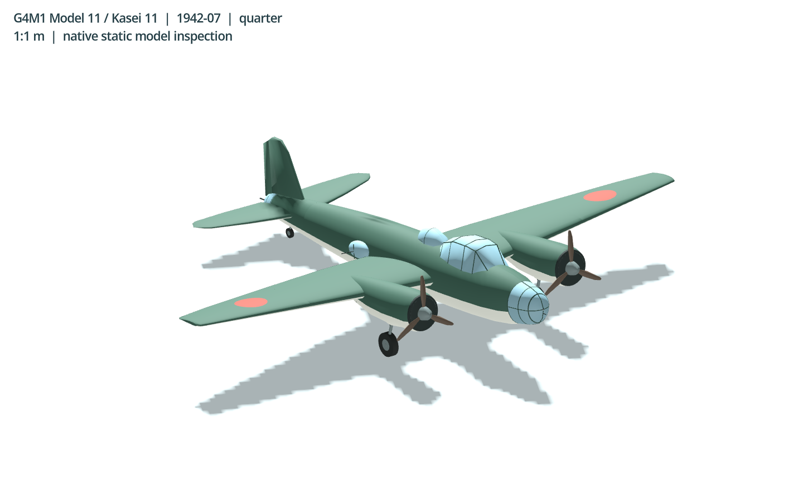
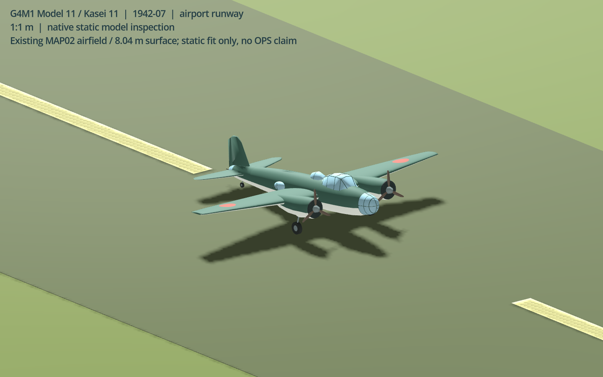
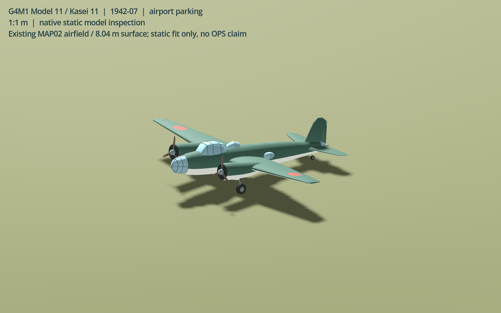

# AV03 G4M1 一式陆攻一一型交付

2026-11-11，Owner `AV03`。**独立模型、接口和实际MAP02静态机场安装已实施；167项专属检查通过，模型冻结，待统筹最终验收。** 统筹已实际确认最终侧/前/顶/斜前的阶梯罩体、贴合舱沿、梯形外翼尖及完整圆标可接受，不继续微距细化。未注册普通Showcase，不等同于OPS、BOMB、DM或Chrome机群完成。

## 范围与入口

- [纯模型](../../../aircraft/g4m1/g4m1.tscn) / [模型源码](../../../aircraft/g4m1/g4m1.gd) / [独立检视](../../../aircraft/g4m1/inspection.tscn)。本机局部[geometry.gd](../../../aircraft/g4m1/geometry.gd)沿用项目通用图元思路，不引用共享Builder或D4Y飞机几何，不是其他机型放大换色。
- [使用接口与状态字段](../../../aircraft/g4m1/README.md) / [Godot实际导出接口](../../../aircraft/g4m1/data/interfaces.json) / [未注册参数与载荷提案](../../../aircraft/g4m1/data/proposal.json)。
- [精选参考卡](../../references/aircraft/g4m1_1942/modeling-brief.md) / [逐图图源与权利](../../references/aircraft/g4m1_1942/sources.json) / [原图与模型对照](../evidence/AV03/comparison.md)。
- [冻结清单与SHA-256](../evidence/AV03/manifest.json) / [实际运行索引](../evidence/AV03/verification-index.json) / [清理](../evidence/AV03/cleanup.json)。

只写本机`aircraft/g4m1/`、`tests/av03/`、`tools/av03/`、专属参考/证据及交付索引。已冻结SB2C保持原样；没有修改共享Builder/Adapter、AircraftMotion、OPS/BOMB、注册表、普通入口/白名单、其他模型或MAP02。根无Git，实施前记录[共享基线](../evidence/AV03/baseline.json)，首轮模型/检视/测试源码另保存在`round1/source/`供前后复核；未假设已有提交恢复点。

## 身份、外形与证据

锁定 **1942-07、G4M1一一型、火星11型双发、三叶桨、原式玻璃机鼻/尾罩及背/侧水泡枪位**。不是G4M2上炮塔/翼鼻，也不是白色拆武装投降运输机；不声称精确复刻某一尾号或架次。深绿/灰色面与不透明玻璃沿用已认可的简化标准，无新AI几何图、发动机内部、密铆钉、精细内舱/轮舱或复杂传动。

实际打开11张互补Tamiya成品照片，覆盖完整近侧、完整斜前、高位展开翼、斜后、机腹和各主要防御枪位；同时实际看说明书第1/7/8/9页、USAAF1944-09原页和2014历史文章。各自身份、透视、有效像素与限制分开记录。战时文字交叉确认通常武器数量/口径及投弹前拆盖；不把其泛称转动360°当成无限射界。原图版权和`.gdignore`限制保留，不把照片用于游戏纹理。严格实机前/顶视、批次炮架厂图和重量/性能条件仍有缺口。



首轮已形成完整厚机身、细长后段、双发短舱和翼尾布局；统筹退回圆泡座舱、过圆翼尖和破碎标志。最终只改这些问题：阶梯风挡与较平罩顶、主纵框与嵌入机身的舱沿、梯形截短翼尖/小圆角、贴合完整翼面圆标，省略小侧窗。首轮与r2证据保留，没有用旧截图冒充当前源码。

名义长19.97m、翼展24.88m；中性炮位的可见全长20.135m（含前突出枪口，比名义值多0.165m/0.83%），实测翼展24.879999m。不整体缩放补偿枪位/端点的照片估计。静态中性桨相位可见包围盒高4.43m；这不是整周桨盘或历史停机高度。公开高度、重量和速度的姿态/装载条件不清处保留空值或原标签，没有拼成已完成飞行性能。

## 纯模型及后续消费

固定米制原点`(0,0,0)`，+X右/+Y上/−Z前，scale=1；原点不是实测重心。未来飞行适配平移为零，不使用SB2C的−2.38m偏移。模型仅消费快照，宿主推进相位和运动：

- 两发动机与两桨独立，左右相位分别输入；失效由宿主停止/减缓相位，不由模型随机造故障。
- `gear`连续0–1，简化主轮后收、尾轮前收，末端显隐/盖板切换；襟翼0–35°，独立副翼、左右升降舵和方向舵±0.35rad。活动轴保留独立，精密轮舱/全机构扫掠未核实。
- 五个独立手动防御枪位：机鼻、背部、左右侧各一挺7.7mm，尾部一门20mm。武器族提案为海军九二式/九九式一号；具体子改型、备弹和历史精确射界尚未取到批次资料，不登记弹道/无限弹药。实际yaw/elevation和枪口Marker随动，−Z为各枪局部出射方向。表现限位不是开火许可，BOMB01仍须校验罩体/自遮挡、翼尾、桨盘、地形及友军。
- `bombs_12x60`默认12枚60kg级简化弹体（720kg），两组六枚、四纵列各三枚，实际逐枚挂点和释放点；具体弹种/引信未复刻。`empty_open`无弹开舱，`ferry`无弹、安装可拆整流盖；盖板是地面拆装状态，没有虚构开合门或投弹摆架。`bomb_visible[12]`仅显隐，不投放、不扣弹。
- 鱼雷只有单独保留的`TORPEDO_RESERVED`参考点，未制作/未合格安装，不与炸弹混挂。无尾钩、折翼或航母回收。
- 六个损伤宿主：center、left_wing、right_wing、tail、engine_left、engine_right。两发动机分别属于对应机翼，主轮归本侧发动机；断翼使发动机/轮组随翼离开，单发动机隐藏保留整翼。尾部含平垂尾/舵/尾轮/尾炮。接口只有附着显隐，脱落运动/残片/烟火归DM，不随机制造战损。

实际路径、挂点方向/坐标/来源状态、部位包络和碰撞建议都在接口JSON；未创建真实物理碰撞体或注册表。父翼包络含发动机，后续命中系统不能把父/子AABB重复计作独立装甲。

## 停机姿态、净空与实际机场

主轮中心`(±3.85,−1.98,−4.05)`、半径0.52m；尾轮`(0,−0.96,8.00)`、0.21m。均是实际轮网格中心/半径，照片估计。三点支承解得 **6.307°俯仰、Y=2.043078m**，接触误差不超过`1.6e-7m`；没有拉长尾轮、改原点或缩机体制造接地。

| 完整停放检查 | 最小净空 m |
| --- | --- |
| 两桨整周旋转包络，额外扣0.025m保守量 | 1.12292 |
| 机腹及12枚炸弹 | 0.62254 |
| 左/右全下放襟翼 | 2.04937 |
| 可拆整流盖安装状态 | 0.66358 |

真实MAP02输入通过既有TerrainQueries编译，画面直接使用现有MAP02表现器；顶面8.04m。对跑道中心、滑行道中心和8个发布停机位逐项安装真实机体姿态/轮组，全下襟翼时检查三轮支承及完整可见网格包络与建筑代理无交；最大轮接触误差小于0.003m。原型Woleai只在早期接口检查出现，**最终已改为MAP02真实输入**，未将其混称MAP02。





16m滑行道的翼尖每侧外伸4.44m，三轮支承及静态建筑净空通过不代表整翼均在硬地内，也不等同于实际滑行、交通、转弯、机库穿越、起飞或降落。MAP02未修改；OPS仍须消费实际机体和地形继续验收。

## 验证、预算与复建

所有Godot/headless/native和PDF渲染都经`tools/verify.py --owner AV03`同一flock，固定`4.7.2.stable.official.ed1daf0bf`、Compatibility；短超时、低优先级、屏外临时窗口并自动退出。没有新开聊天/子代理、浏览器/HTTP服务或FFmpeg。静态文档/JSON整理与哈希归档不启动引擎。

最终专属检查`20261111T122151-439110af`退出0，**167项、0失败**。覆盖双实例状态隔离、有限数输入/限位、两桨/五炮口/控制面、逐弹可见状态和朝向、独立发动机与翼尾层级、三轮接触、整周桨盘/机腹/襟翼/盖板、实际MAP02支承/建筑净空和源网格预算。完整命令/输出见运行索引及[contracts.json](../evidence/AV03/contracts.json)。

最终18张模型/状态图与2张MAP02组合图，1440×900；运行`20261111T122152-0f959d80`和`20261111T122404-2bc87046`均退出0、无诊断错误、清理成功。每张PNG附JSON，含相机、原点/比例、状态、Godot版本及源码/依赖哈希。正常距离、减速/放轮中间态、襟翼、四类炮位、载荷、ferry和分组隐藏可直接查看，未用AI替代实际画面。

原始208个网格按固定材料/损伤宿主合并后为**104个MeshInstance、55,884个三角面（所有配置合计）**。活动轴/逐弹/桨/轮保持独立。这是源几何统计，不是Chrome机群性能；未按微距细节继续增加节点。

最短有界检视命令（仓库根；输出后自动退出）：

```sh
nice -n 10 python3 tools/verify.py --owner AV03 --timeout 25 --lock-timeout 45 godot --render -- --rendering-method gl_compatibility --audio-driver Dummy --resolution 1440x900 --position 5000,5000 --quit-after 600 res://aircraft/g4m1/inspection.tscn -- --view quarter --capture /tmp/av03-quarter.png
python3 tools/verify.py --owner AV03 --timeout 30 --lock-timeout 45 test res://tests/av03/test_g4m1.gd
```

其他`--view`：side/front/top_flight/high_rear/observer_flight、gear/tailgear/transition/landing、bay/ferry、nose_gun/dorsal_gun/waist_gun/tail_gun、damage、airport_runway/airport_parking。阶段图分别留在round1/round2/final，不能用首轮源码替代当前形体。

所有验证运行保留；资料下载中的两次TLS超时在acquisition.json明确标为未取得，未算已看原图。未使用收费/登录资料、未新建账号。最终日志/进程组及共享锁状态以cleanup.json为准；只核本任务已登记的子进程组，不关闭用户或OPS01进程。

## 接续边界

未完成飞行性能注册、水平轰炸、有限防御火控/弹药、真实陆基起降、损伤残片运动或普通场景/Chrome。尺寸/性能提案保留原来源条件、质量标签和null缺项，不把较晚期G4M2航程套入本型。模型到正常观战可辨和可靠静态装配为止，交统筹最终验收；本任务结束后停止，不自动开始Ki-21或其他机型。
