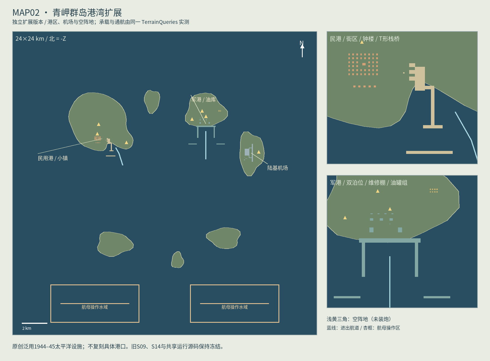
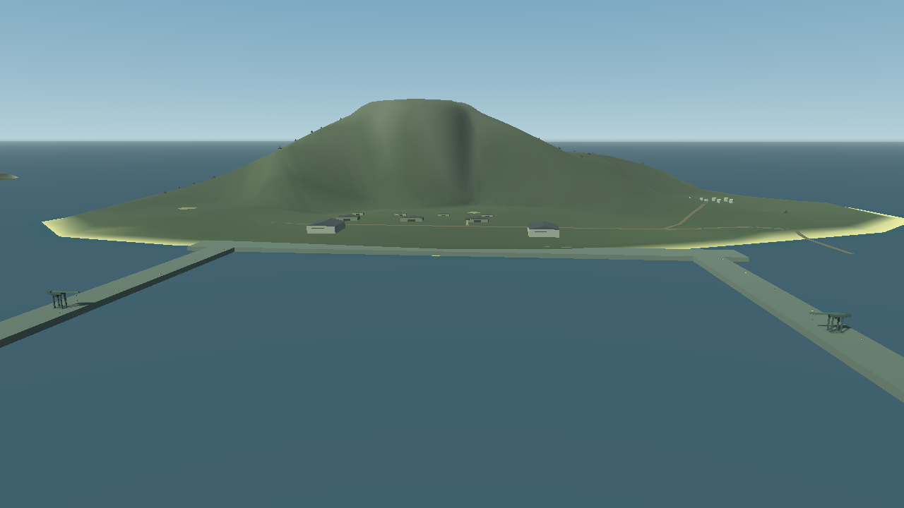

# MAP02 港口、军港、小镇与阵地场景

2026-11-11。**独立静态地图自验通过，待统筹复核；S14扩展接入与Chrome未做。** 当前19单位基线、旧S09地图和根大和入口均未替换。本轮完成12类模块、99处设施、同源地形/碰撞代理、7处空阵地，以及机场/外海操作空间的静态交接。没有新增战斗单位、起降/轰炸行为或地面火控。

## 入口与文件



- 全图：`res://scenes/map02/expanded_map.tscn`；模块：`res://scenes/map02/facilities.tscn`。使用独立静态检视器，区域下拉/1–9定位、右键环绕、滚轮缩放、Shift+WASD、H显隐面板及暂停海面可供检视；不接共享Session。
- 地图：`data/maps/island_harbor_expanded.json`。设施模块/实例/区域：`data/map02/`；私有适配：`scripts/map02/`；专属检查：`tests/map02/`；生成/布局/编码/归档：`tools/map02/`。
- [区域说明](../../maps/MAP02/layout.md)、[设施/阵地/OPS接口](../../maps/MAP02/interfaces.md)、[冻结边界](../../maps/MAP02/boundary.md)、[资料与近似](../../references/maps/MAP02/modeling-brief.md)、[来源台账](../../references/maps/MAP02/sources.json)。没有需要本轮落地的公共地形变更。

| 模块 | 实例数 | 场景用途 |
| --- | --- | --- |
| 民居 / 商铺 / 会馆 | 44 / 5 / 1 | 有街道间隙与公共广场的低层小镇，色调/屋顶与军港区分 |
| 控制塔 / 货仓 | 3 / 3 | 民港、军港、机场各一塔；民港三处货仓 |
| 吊机 / 系缆设施 | 3 / 17 | 实体立腿/底板连接码头，保留空隙，无运作动画 |
| 维修棚 / 军需仓 / 营房 | 2 / 3 / 6 | 两条军港泊位后方的大棚、仓储及生活勤务区 |
| 油罐 / 机场机库 | 10 / 2 | 军港8罐、机场2罐；机场机库与机坪相连 |

另有实心码头/岸壁/防波堤、跑道/滑行/机坪硬地、标线、道路和7处地坪。共432条组件/硬地记录，其中245条进入共享实体代理。没有照片贴图或第三方模型。

## 同源查询与交接结果

现有TerrainQueries编译11724个地形三角形，实际renderer使用同一三角面；MAP02不另算高度。建筑、油罐、吊机等组件由同一position/size同时生成可见几何和有限包络代理。码头首次接触/最高顶面与支承一致：民港10m、军港12m；机场硬地8.04m。建筑命中分类building，硬地/码头ground；屋顶和圆罐用保守AABB，误差及不可进入内舱的边界已写入接口文档。

全部99处设施检查主要落地部件四角的实际陆地/码头支承；7处阵地验证平整、整圈陆地支承及90m安装柱体无设施代理。美军3处用已准入5in/51和40mm M1走现有GroundDeployments.expand/validate，真实炮口与承载通过，未安装战斗模块。日军4处保持空阵地，由AA02核准炮型后正式部署。水上服务挂点不能直接送入仅接受陆地的旧GroundDeployments，接口已明确。

民港120m、军港220m膨胀半径的发布航道均可由原TerrainNavigation直接通行；建议船长/宽分别130/22m及280/42m。这是几何净空，不是靠泊/转弯动力学验证。外海两处7×3km水域及5400m直线以350m舰体余量检查。机场1400×58m跑道、760×16m滑行道、两横向连接、8个停车位和两侧进近参考线均有实际净空/支承检查，OPS01仍须验证具体飞机及完整作业。

## 验证、画面与预算

[证据索引](../evidence/MAP02/evidence_index.json) / [源码哈希](../evidence/MAP02/source_hashes.json) / [冻结边界核对](../evidence/MAP02/frozen_boundary.json) / [验证运行](../evidence/MAP02/validation_runs.json) / [清理](../evidence/MAP02/cleanup.json)。Godot版本每轮均由tools/verify.py核对为`4.7.2.stable.official.ed1daf0bf`。

实施前与交付时实际检查均显示当前目录不是Git仓库；未创建提交或假定已有恢复点，以本轮开始冻结快照、最终资源哈希和完整验证日志供复核。

| 检查 | 最终结果与证据 |
| --- | --- |
| 同源查询与安装 | 1015项、0失败；含99处支承、7处阵地、真实地面安装入口、首次接触、航道、跑道/滑行/停车及进近；[terrain_checks.json](../evidence/MAP02/terrain_checks.json)，运行`20261110T211302-0a99fdf5` |
| 模块原生 | 1280×720，12个模块近景+总览+普通UI共14张；[module_capture.json](../evidence/MAP02/module_capture.json)，运行`20261110T210840-d75b559d`；实际查看会馆、棚/机库、罐、吊机等大形与连接 |
| 全图原生 | 9个区域+普通UI共10张，80帧连续检视；[map_capture.json](../evidence/MAP02/map_capture.json)，运行`20261110T210906-757ee8c4`；源码哈希在捕获前后相同，场景回收后子节点为0 |
| 连续检视 | [inspection.mp4](../evidence/MAP02/inspection.mp4) / [关键帧板](../evidence/MAP02/sequence_contact_sheet.png)，1280×720、80帧、8秒；民港低位→军港低位→机场→油库，各段连续环绕；相机实际离地最小137.59m。10fps是证据编码节奏，不是游戏帧率，也不是飞机/OPS演示 |
| 几何/绘制 | 全图静态25242三角形、4个MeshInstance、3种地图材质；私有地图节点共5。150000三角形上限通过。原生近景含阴影多pass最高77492绘制三角形/13 draw calls；普通UI总览15 calls。外海固定相机显图4 calls/15922三角形，隐藏图1 call/2三角形。不是Chrome性能结论 |



生成与检查命令（仓库根，验证串行；预览最小化且自动退出）：

```sh
python3 tools/map02/build_map.py
python3 tools/map02/plot_layout.py
python3 tools/verify.py --owner MAP02 --timeout 75 --lock-timeout 3 test res://tests/map02/test_map02_terrain.gd
python3 tools/verify.py --owner MAP02 --timeout 90 --lock-timeout 3 godot --render -- --minimized --script res://tests/map02/capture_map02.gd -- --gallery
python3 tools/verify.py --owner MAP02 --timeout 90 --lock-timeout 3 godot --render -- --minimized --script res://tests/map02/capture_map02.gd
python3 tools/verify.py --owner MAP02 --timeout 55 --lock-timeout 3 exec -- python3 tools/map02/encode_inspection.py
python3 tools/map02/finalize_evidence.py
```

## 失败修复与清理

保留全部失败与通过日志，没有以最新绿灯覆盖历史。初次受限运行还出现Godot用户日志/证书访问诊断；受控放开引擎运行权限后使用同一锁和清理路径。地图查询暴露油库原点超出陆地、高地站点落在坡面、机库4cm台面差和北进近穿入丘陵；修复为油库内迁、站点移到真实平地、扩展机坪并对齐8.04m硬地、独立东北岛网格细分和机场地坪范围修正。仅改扩展地图数据。

第一次模块原生显示方墙平滑法线导致暗三角，私有renderer改成工业体块硬边法线并调整自身灯光偏移，最终模块和全图重新捕获。不会因缺少微距小零件返工。最后补验安装柱体内部无遮挡，不增加公共代码。

所有MAP02引擎与编码经同一验证锁运行，10轮记录的19个进程组均回收，最终存在性审计确认全部已退出。最终源/证据与遗留进程核对由cleanup.json记录；未启动HTTP服务、Chrome/Safari或编辑器，未关闭用户已有窗口。原地图、三份公共地形脚本、原地图renderer、Session/game、海面/海岸shader、GroundDeployments和project.godot共11份冻结文件哈希全部保持本轮开始值。

## 后续边界

设施仍是静态环境，没有建筑损伤状态或动画。机场参考已有原型的组织但未复用其装饰炮和航点飞行动画；跑道长度与位置为架空场景估计。AA02、CV01/CV02、OPS01及BOMB01拥有各自真实行为；S14扩展完成实际装配后再由S08调度Chrome/性能/长时验收。本交付不替代这些能力的验收。
