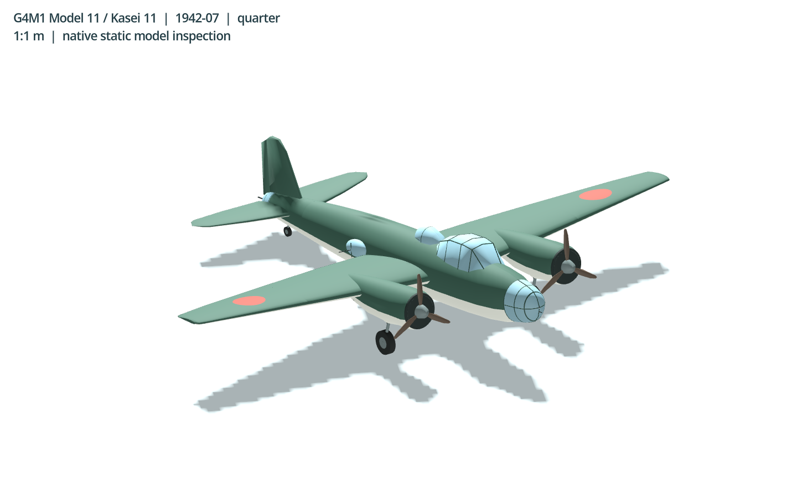
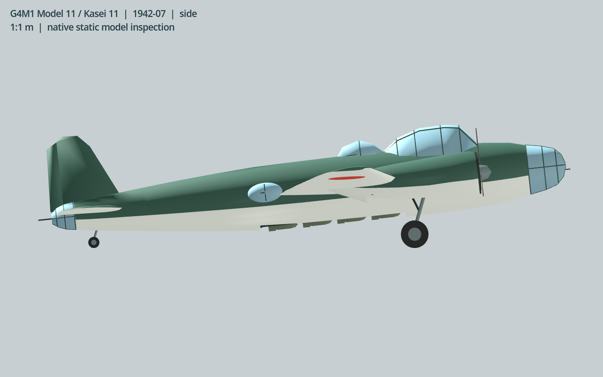
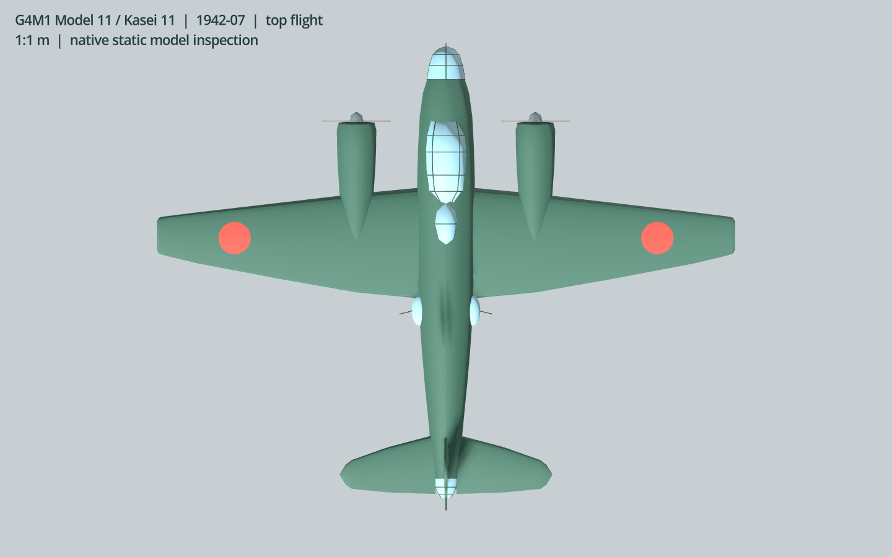
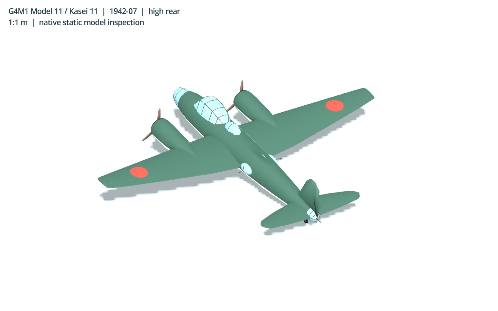
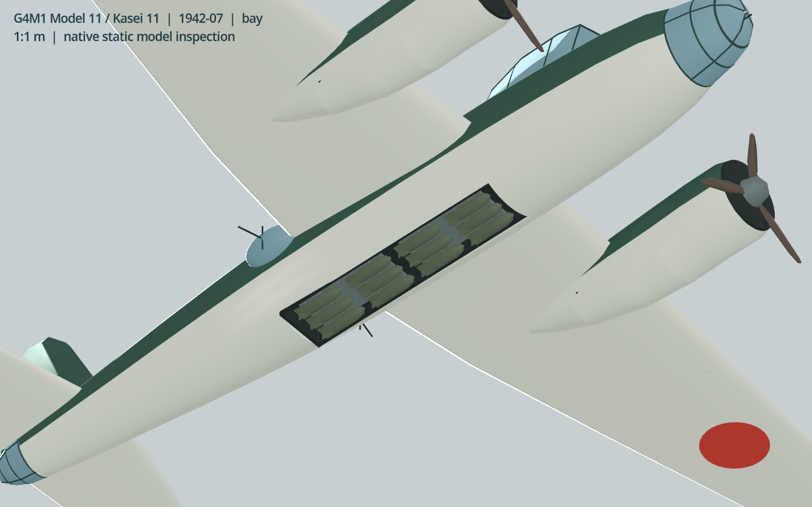
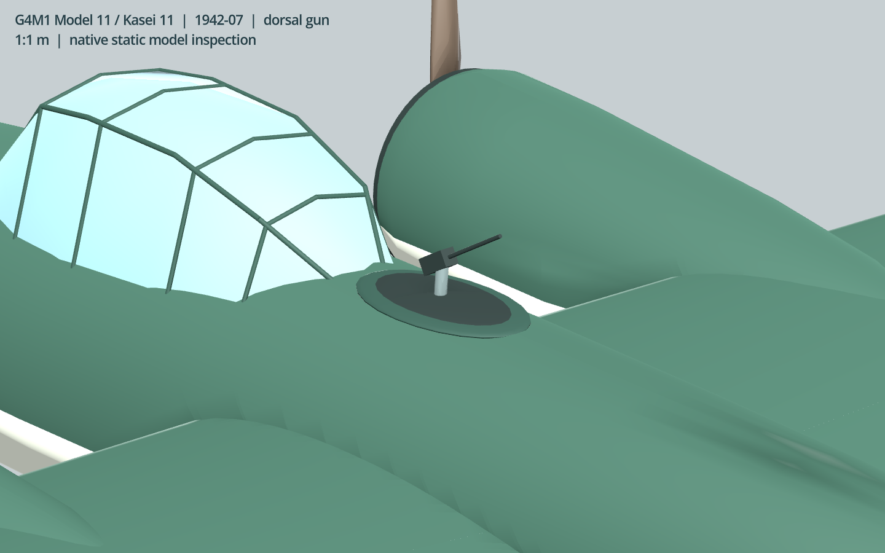
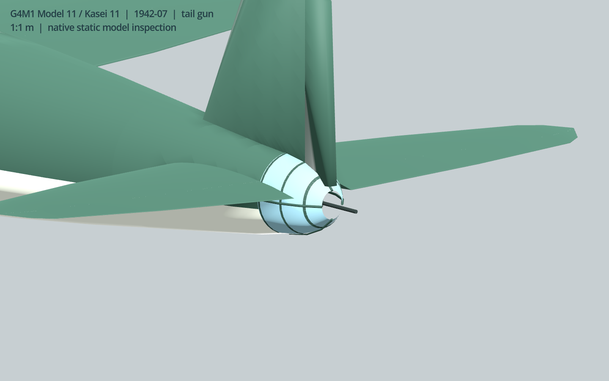
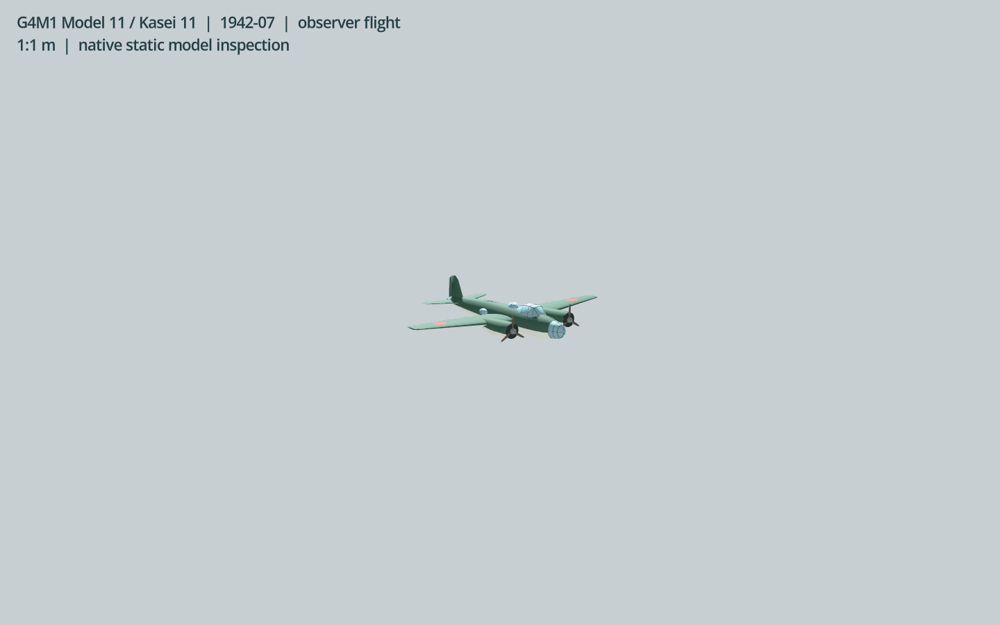
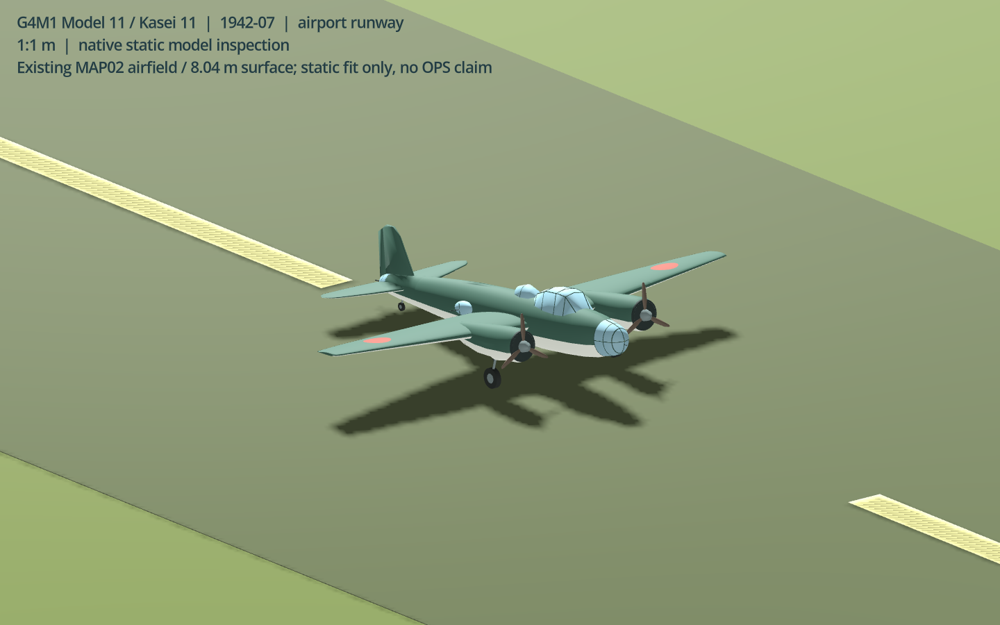
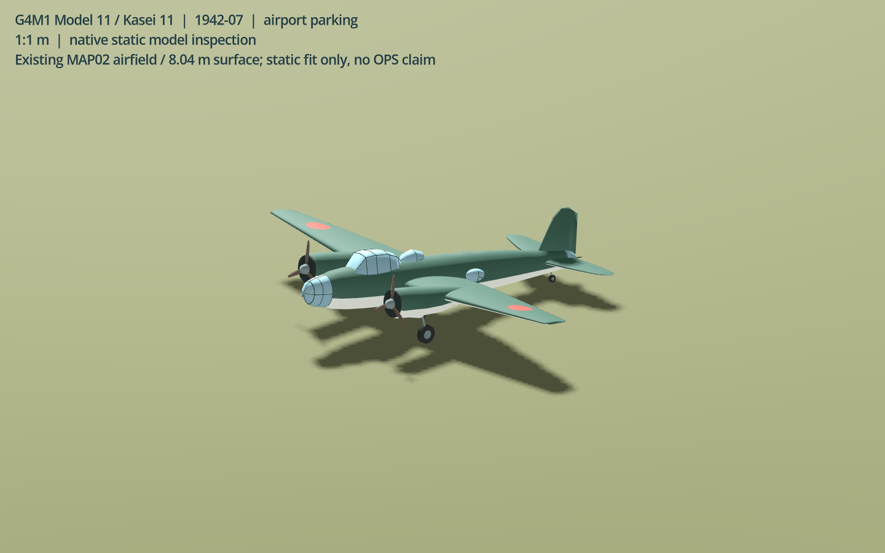

# AV03 原图与同模型对照

2026-11-11。原始照片、PDF原页渲染和Godot画面分别保存。相机、模型姿态及源码哈希在每张PNG的同名JSON内。当前风格沿用已认可简化标准，没有新造AI结构图。

| 原始成品照片 | 最终Godot模型 |
| --- | --- |
|  |  |
|  |  |
|  |  |
|  |  |

原图为Tamiya一一型成品照片，非战时实机。模型相机朝向近似，未取得摄影内参，不作逐像素测绘；侧图是停放、顶图是水平收轮，状态差异显式保留。模型不移植359号、K-310或其他迷彩机的身份。大机身、长尾段、双发和翼尾比例已交统筹；r1偏圆罩体和翼尖被退回，r2采用阶梯风挡/较平屋顶、贴合舱沿、梯形翼尖，完整圆标与省略小侧窗已获认可，不继续细化。

| 主要装配原图 | 实际装配 |
| --- | --- |
|  |  |
|  |  |
|  |  |

弹舱为地面拆盖的真实战斗形态；盖板安装只用于无弹ferry配置。鱼雷图M05只证明互斥载荷外观，不表示本轮已做鱼雷。枪位各有独立轴/枪口；杆、截面和角度限位是照片估计，未宣称复刻内部炮架。浅色罩体为不透明简化玻璃，不要求内舱。

以上机场画面直接读取现有MAP02同源地形/设施渲染器与数据，没有另造小地坪顶替，也未修改地图；飞机按8.04m支承面和真实轮组停放变换安装。它证明静态形体与接地，不替代OPS滑行、起降、动态净空或BOMB行为。
