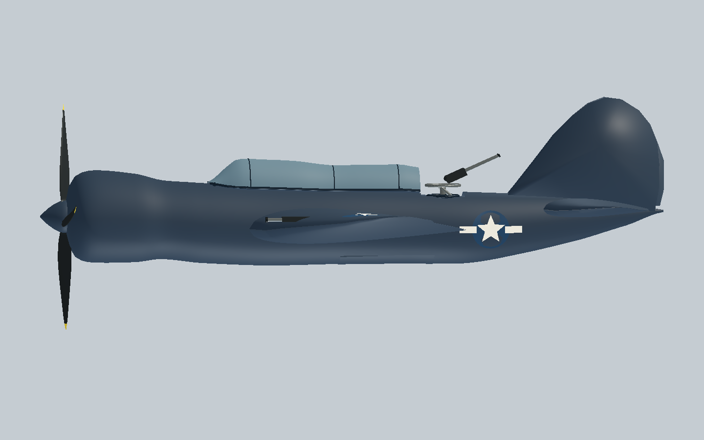
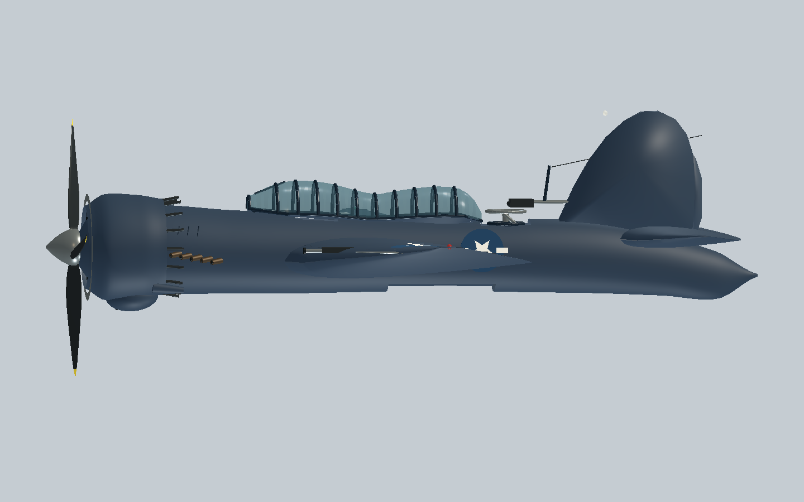
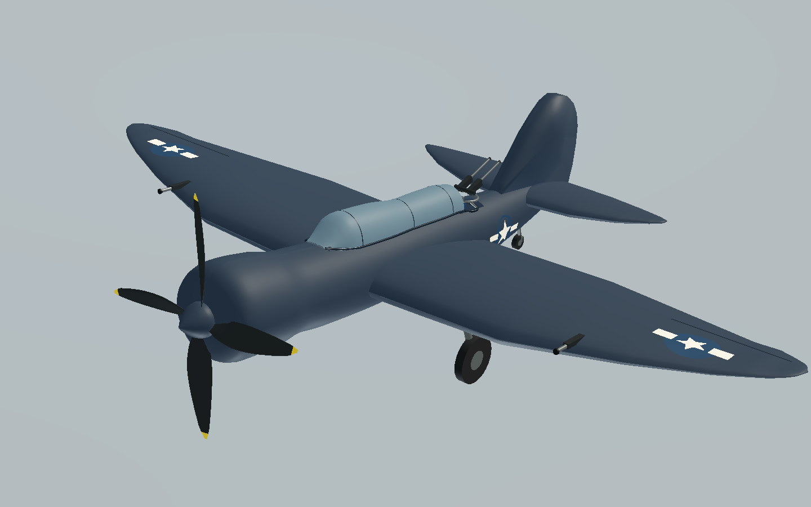
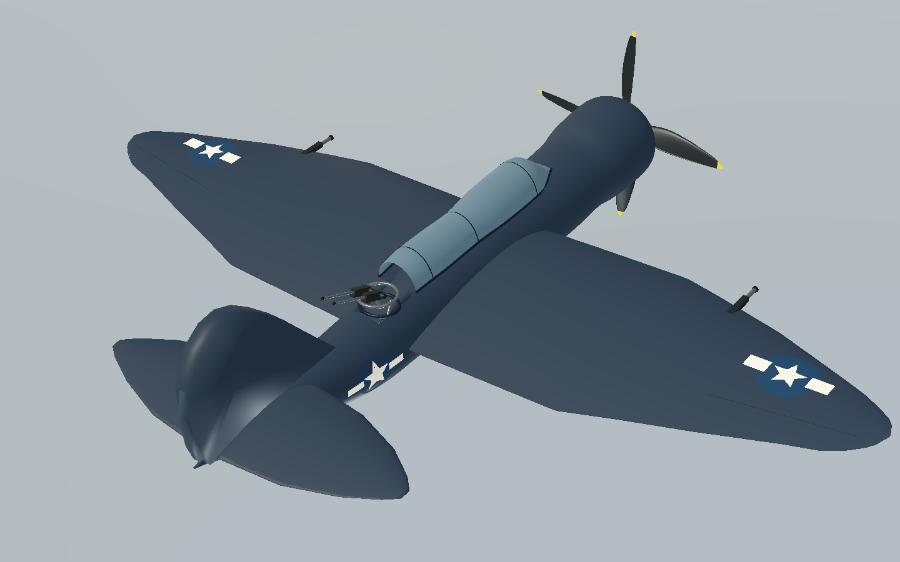
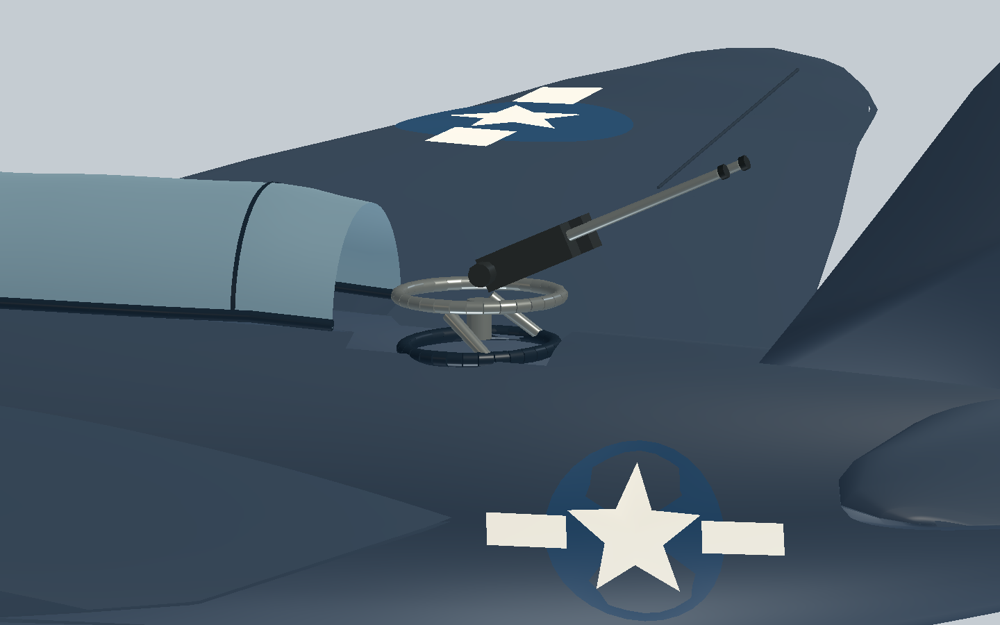
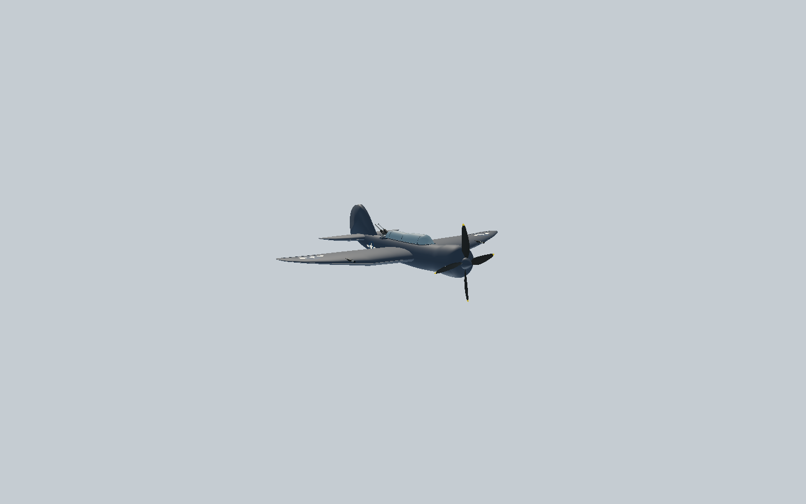

# SB2C 原始资料与同模型对照

2026-11-11。原始照片、AI 风格图、Godot 画面分别保存。以下模型截图均来自本轮冻结源码；相机参数与哈希在各 PNG 的同名 .json 中。照片没有作形体修补或 AI 处理。

## 飞行侧轮廓

| 实机原始公开预览 R04 | Godot 最终飞行形态 |
| --- | --- |
|  |  |

R04 的馆藏身份为 SB2C-4、左侧飞行照，公开预览仅 400×327（机体有效宽约 277 px）。只能核大形、后腹收束、风挡位置与尾轮大致站位，不能据此声称精确厂图坐标；不将它当作历史涂装模板。最终模型为收轮飞行检查，原图尾轮可见，两者状态差异保留。

## 同机位的修改前后

| 本轮最初模型，同向飞行侧视 | 最终模型，同一相机与飞行姿态 |
| --- | --- |
|  |  |

这一对相机位置、旋转、投影、尺寸相同。共享 builder 哈希并不相同，`manifest.json` 的 `same_before_after_side_shared_builder` 为 `false`：期间 DM01 修正了 F6F/A6M 的主轮舱盖分支；SB2C 使用自身的起落架构建函数，不调用该分支。最终14张图及接口检查均对应同一当前 builder。此差异已由[统筹独立复核](../../acceptance/SB2C-admission-review.md)确认，不能将前后图说成全部依赖完全相同。机身长宽没有整体缩放。主要差异是连续圆鼻、加深中机身、向上收束的后腹、尾端与垂尾关系，以及后倾风挡。r1 只作中间反例留档，不作为最终交付。

## 斜前与斜后完整对照

| 原始成品模型照片 | Godot 简化模型，接近方向的停放视图 |
| --- | --- |
|  |  |
|  |  |

R01/R02 是同一作者的 1/48 成品相册，原照片有透视及打开的减速板。模型使用透视相机并采用简化停放姿态、闭合面板。方向和占幅已校，但摄影内参未知，不作逐像素测绘或历史独立来源的双重证明。

## 安装与正常观察距离

| 主要承载局部原图 R05 | Godot 必要支撑 |
| --- | --- |
|  |  |

枪架只保留环轨、短支撑和双枪外形；原图能支持环轨/围框与枪座的关系，无法证明内部全机构。枪身整体静态上仰 24°，避免穿入垂尾，尚未接火控。小孔与内部机械不制作。

以上为真实 Godot 原生画面，非 AI 图。AI v04 仅作曲面/纯色/简化程度目标，见原参考目录，不能作为历史形状或本轮运行证据。

正前和俯视截图只证明本模型的对称、比例和连接；本轮仍未取得可量取的同子型实机正前/严格正投影顶视原图。尾轮和支杆坐标、罩体截面与枪架精确尺寸仍属于照片估计。
