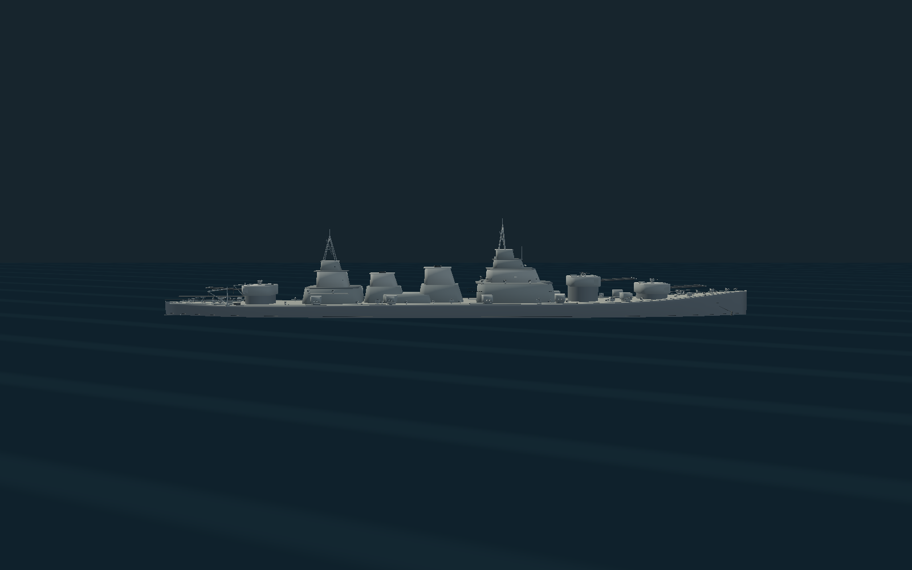
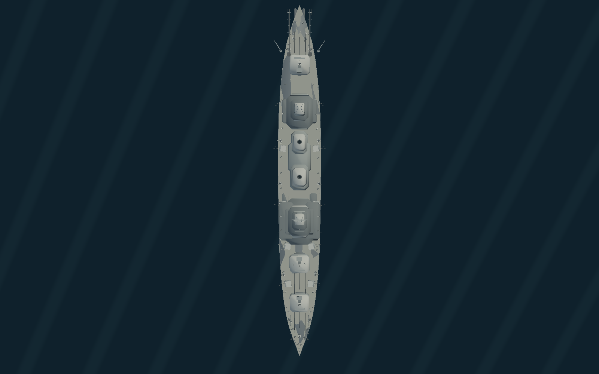
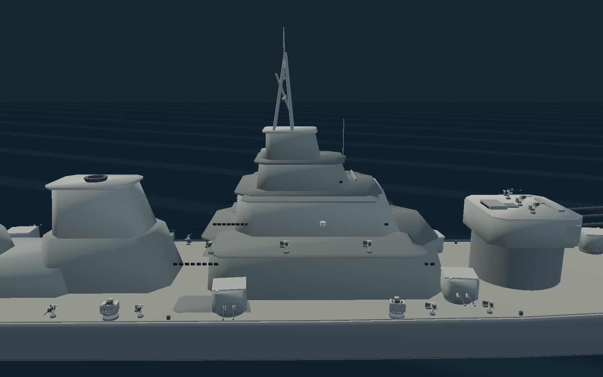

# Reusable weapon modules — 5 November 2026

The three small-caliber weapon families have been moved from per-mount geometry generation into reusable scene resources. The scene baker is `tools/bake_weapon_modules.gd`; rerunning it writes all four weapon resources, including the existing 16-inch turret:

- `scenes/weapons/secondary_5in38_twin.tscn`
- `scenes/weapons/bofors_40mm_quad.tscn`
- `scenes/weapons/oerlikon_20mm_single.tscn`

Each installed mount now has a host marker, an individual fixed foundation, and a named `WeaponSeat` that holds an instance of the shared weapon scene. Each instance keeps its own `TrainPivot` and `ElevationPivot`. Roof-mounted light AA is parented to the marker on its host turret roof, so it continues to move with that turret.

Foundation interfaces are currently visual estimates stored under `foundation_interfaces` in `data/december_1944.json`: 5-inch/38 uses 4.0 m diameter and 0.64 m height, Bofors uses 2.1 m and 0.28 m, and Oerlikon uses 0.76 m and 0.24 m. These values only define the current model connection; they are not measured installation dimensions. All station coordinates and display motion rates remain provisional as recorded in the same file.

## Native captures

The scenes were baked and loaded in Godot `4.7.2.stable.official.ed1daf0bf` with the Compatibility renderer on Apple M5. The native visual pass checked the overall arrangement and the small mounts near the forward battery. The automated mount test was not run during this pass.

## Remaining work

- Replace estimated foundation interfaces and station elevations with measurements from a dated Iowa installation drawing.
- Refine the geometry of the small-caliber weapon mechanisms and add historical fittings only when supported by references.
- Compare the new stern catapult and crane modules against higher-resolution Iowa photographs, then refine their station interfaces and operational pivots.
- Re-run `tests/test_mount_assembly.gd` after the next requested verification pass.
